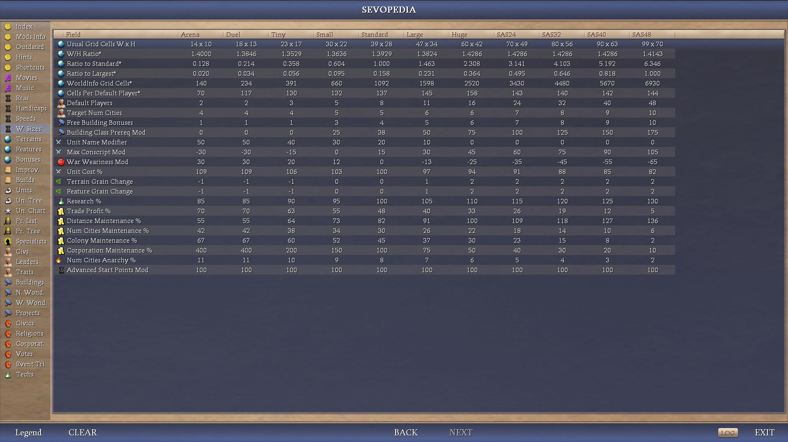

# AdvCiv-SAS (Simple Advanced Strategy)

AdvCiv-SAS (Simple Advanced Strategy), sometimes called SAS or the SAS mod, ([Discussion thread here](https://forums.civfanatics.com/threads/advciv-sas-simple-advanced-strategy.699716/)) is a mod based on [AdvCiv 1.14](https://github.com/f1rpo/AdvCiv/tree/1.14), and will/may update whenever there are new changes that are stable.

AdvCiv-SAS is now available at [CFC Modpacks downloads section](https://forums.civfanatics.com/resources/advciv-sas-simple-advanced-strategy.32513/) and at the [ModDB website](https://www.moddb.com/mods/advciv-sas-simple-advanced-strategy), not just on github anymore (read [below for download/install instructions](/README.md#how-to-play)).

The core changes brought by this mod are as of now an AI overhaul to make it much more efficient with its workers and settlers and most gameplay areas with a focus on opportunism and avoiding self-sabotaging/suicidal AI play.

Heavy reworks were made, while otherwise mostly staying in the base AdvCiv frame, but with a focus on game balance, generally more historical accuracy (but not too much else gameplay is impractical (e.g. religions appearing too late or too few or not varied enough to be gameplay relevant or effective at all)) and strategic value (e.g. if all religions beeline from same tech path it would not be too balanced or strategically diverse or valuable), and as for in particular UI in Sevopedia (e.g., item grouping, new Search Bar, Keyboard navigation (UP/DOWN for category-list items; LEFT/RIGHT for BACK/NEXT pages visited), Index as Category, new charts and Leader AI Personality Panel, Media Player (Movies with audio support, and Music with the ~1750 audio scripts that can be listened to), Vote (Votesources and Votes), EventTrigger (Event Triggers and Events), Exapnded Text Panels), and the city screen rework, main Menu rework (notably multiple random main menu music support (shuffle-bag)).

Among notable UI changes, advisor screens have been reworked or new ones were added (e.g., new World Advisor with detailed geography information per city in BFC, suburbs, and territory; new Summary Tab, new Composition Tab, new Battles Tab (Military Advisor); new Score Tab and Timeline tabs (Info Screen)); and they now dynamically adjust to game resolution.They were also were expanded so they use more of the available screen space (notably now optimized for a 16:9 display), reducing the need for players to scroll, and with new information displayed as well. Advisors have been reorganized for easier, logical, and even access (e.g., merge the Espionage Screen so it is now a tab of the Foreign Advisor, merge Civics, Religions, and Corporations so they are now tabs of the Policy Advisor).

A significant UI addition is optional text upscaling (regardless of game resolution) from font 1 (smallest text size) to font 4 (largest text size) which especially helps at higher resolutions or to improve readability on lower resolutions. Or the new Scoreboard scroll up and scroll down buttons, center scroll on the active player, toggle autocenter scroll on the active player, toggle lock hover, and toggle background style buttons, and the do not render beyond bottom of commerce sliders behaviour.

New mechanics as well, including but not only new Game Speeds (`Nitro`, `Turbo`, `Slow`, `Very Slow`); new World Sizes (`Arena`, `SAS24`, `SAS32`, `SAS40`, `SAS48`); new Handicaps (`Rookie` and `Deity+`) for finer/gradual grain and broader challenge, new optional XML fields (e.g., `ObsoleteTech` for units, `EraArtDefineTags` and `EraArtDefineTag` for leaderhead era art); new Mapscripts (e.g., `BTG_Cross`, `BTG_Lagoon`, `Equal_Islands_V2_beta`, etc.), including AdvCiv-SAS original ones (e.g., `SAS_Large_Facing_Islands`, `SAS_Longworld`, `SAS_Parallel_Lines`, `SAS_Spiky_Avenues`).

Content overall addition is minimal, as of now mostly in the future era (like the new camel bonus, or the new playable civ Kingdom of Benin (Ewuare), Irish Empire (Grace O'Malley, Michael Collins)); else it is mostly done via this heavy reworking of the game rather with the aforementioned goals (accuracy, good/strong civ/leader/building/unit/etc blend, balance, AI strength, etc).

Many practical changes are made, notably moving BBAI logging to SAS defines so they are now easily tunable and accessible without requiring DLL modification and recompiling anymore (restart Civ4 to apply changes). This is deemed valuable not only for modders, but also for users who can now view or generate logs. Since BBAI log files are usually very long, we generally give them to external LLMs like ChatGPT which as of now gives us an agentic-token-free analysis (e.g., Codex, Claude Code) (also good to give us a different point of view/review if needed).

Note: they are now optionally written to a new timestamped file for each new game or loaded save (e.g., `BBAI_20260705T071718Z_new1.log` or `BBAI_20260705T071718Z_load2.log`) instead of expanding the existing `BBAI.log`, which was very tedious to clean up or identify/store/read/review/upload, and so repeated save-file tests no longer require restarting Civ4. Each log begins with the new/load lifecycle marker, shared mod/source commit/version and exact DLL-binary identity, currently active BBAI log levels, and then game settings to help doing that.

A separate `SASGameRecord_*.log` can also be enabled notably for compact autoplay / AI-benchmark review, recording what happened across the run (economy, expansion, city and battle history, worked plots, diplomacy, initial map/landmass geography, etc.) or to give more gameplay context to complement BBAI's detailed decision traces. It notably also preserves exact high-level AI strategy, victory-route stage and team worst-enemy transitions alongside periodic checkpoints, making shifts in long-term AI intent and diplomatic alignment easier to line up with production, diplomacy and war outcomes without enabling every detailed BBAI category. This is an all-player diagnostic record and can contain spoilers, so it is not a spoiler-free player-advice export.

Other system/tooling convenience enhancements are added to help reduce tedium, notably include SASFastSave (e.g. `ALEXANDER_T0000_HUGE_CUSTOM_CONTINENTS_NORMAL_41500016_41500016_20260909T171232Z_START` or `ALEXANDER_T0459_HUGE_CUSTOM_CONTINENTS_SPACE_ZARA_YAQOB_NORMAL_41500016_41500016_20260910T184208Z`), make save info clearer, and avoid identical filename handling issues, AIAutoPlay runs not being interrupted when the active player dies or other notices so they can continue and complete unattended, or the default number of turns being adjusted to max depending on game speed or tunable (e.g., 501 turns at Normal Gamespeed, 1001 turns at Marathon).

Another significant part of the project is [LLM-assisted source analysis](/README.md#llm-assisted-source-analysis): completed historical archaeology follows BtS, K-Mod, AdvCiv and AdvCiv-SAS changes through their actual diffs and lineage, while current-tree audit albums review final files and cross-file contracts from complementary angles. The completed archaeology records 130+ confirmed candidate bug/issue findings; fixes and newer audits proceed incrementally rather than delaying normal releases. The C++ file audit album goes even further and has found additional hundreds (as of now ~500) of bugs or issues, many of which are inherited from vanilla, Warlords, BtS, K-Mod, AdvCiv, mapscripts, or other sources, and is an as of now unprecedented system Civ4 QA/code audit effort.

All in all, this simplifies gameplay to some extent, but greatly increases depth and should make the game much more challenging while not being too much of a grind (i.e. we don't want to increase penalties at higher handicaps, but instead aim to avoid/reduce them while trying to make the game harder (and ideally harder than base AdvCiv at all handicaps) through improved AI competency rather). There are a lot more changes, and details about these as well below explained in the following sections.

Also most importantly LLMs like GPT Thinking (i.e. ChatGPT), GPT Codex, Claude code, Gemini AI, Deepseek AI, Grok AI, have helped me a lot to do this, and i probably would not have completed (or extremely harder) without them and all i mean so thanks again and thanks a lot!

For license and reuse terms, including project-specific restrictions and expressly permitted derivatives, see [License and reuse](/LICENSE.md#license-and-reuse).

<a href="https://www.youtube.com/watch?v=ipSdRP7HcFs"></a>

## Menu

[Tech Tree](/README.md#tech-tree)\
[Military Tree and changes](/README.md#military-tree-and-changes)\
[Ingame gameplay samples](/README.md#ingame-gameplay-samples)\
[Docs](/README.md#docs)\
[How to play?](/README.md#how-to-play)\
[Full exhaustive very long and exhaustive changes](/README.md#full-exhaustive-very-long-and-exhaustive-changes)\
[Main Changes Guide](/README.md#main-changes-guide)\
[UI (Main Menu)](/README.md#ui-main-menu)\
&emsp;[Home page](/README.md#home-page)\
&emsp;[Simple Game rework](/README.md#simple-game-rework)\
[UI (Ingame)](/README.md#ui-ingame)\
&emsp;[Main Advisors reworks](/README.md#main-advisors-reworks)\
&emsp;&emsp;[New Advisors (e.g., Overview tabs (Domestic Advisor); Summary Tab, Battles Tab, Composition Tab (Military Advisor); new World Advisor; Score Tab and Timeline Tab (Info Screen))](/README.md#new-advisors-eg-overview-tabs-domestic-advisor-summary-tab-battles-tab-composition-tab-military-advisor-new-world-advisor-score-tab-and-timeline-tab-info-screen)\
&emsp;&emsp;[Advisors adjustments](/README.md#advisors-adjustments)\
&emsp;["Willing to become a vassal" and vassal icons in foreign advisor's glance tab](/README.md#willing-to-become-a-vassal-and-vassal-icons-in-foreign-advisors-glance-tab)\
&emsp;[Inverted BUG options](/README.md#inverted-bug-options)\
&emsp;[Diplomacy Screen](/README.md#diplomacy-screen)\
&emsp;[Miscellaneous screens](/README.md#miscellaneous-screens)\
&emsp;[Main interface rework](/README.md#city-screen-rework)\
&emsp;&emsp;[City Screen rework](/README.md#city-screen-rework)\
&emsp;&emsp;[Map view rework (e.g., Scoreboard Toggle and Scroll buttons, Map Annotations Toggle button)](/README.md#map-view-rework-eg-scoreboard-toggle-and-scroll-buttons-map-annotations-toggle-button)\
[UI (Main Sevopedia reworks)](/README.md#ui-main-sevopedia-reworks)\
&emsp;[Some lower level Sevopedia reworks (e.g., Item grouping, Search Bar, Keyboard UP/DOWN (category items) and LEFT/RIGHT (BACK/NEXT page visited) navigation, Index as category, Movies (with audio support), Music with ~1750 audio scripts that can be listened to in Sevopedia), Expanded Text Panels, Expanded Content (Non-text; e.g., Animation) Panels, Expanded leaderhead Panel](/README.md#some-lower-level-sevopedia-reworks-eg-item-grouping-search-bar-keyboard-updown-category-items-and-leftright-backnext-page-visited-navigation-index-as-category-movies-with-audio-support-music-with-1750-audio-scripts-that-can-be-listened-to-in-sevopedia-expanded-text-panels-expanded-content-non-text-eg-animation-panels-expanded-leaderhead-panel)\
&emsp;[Other new categories](/README.md#other-new-categories)\
&emsp;&emsp;[Widget Python 6798 to link (e.g. for Builds, for Traits)](/README.md#widget-python-6798-to-link-eg-for-builds-for-traits)\
&emsp;&emsp;[Charts (e.g. Handicap Chart, Game Speed Chart, World Sizes Chart, Eras Chart)](/README.md#charts-eg-handicap-chart-game-speed-chart-world-sizes-chart-eras-chart)\
&emsp;[Some higher level reworks (e.g. AI Personality Panel, Traits Charts, Starting and Untradeable Techs Charts, Improvement Weights (Leaders) Chart)](/README.md#some-higher-level-reworks-eg-ai-personality-panel-traits-charts-starting-and-untradeable-techs-charts-improvement-weights-leaders-chart)\
&emsp;[Some other Sevopedia reworks](/README.md#some-other-sevopedia-reworks)\
[UI (Common)](/README.md#ui-common)\
&emsp;[Emojis](/README.md#emojis)\
&emsp;[Untradeable techs (bTrade) display information](/README.md#untradeable-techs-btrade-display-information)\
[New optional XML fields (e.g. ObsoleteTech for units, Button for eras, EraArtDefineTags and EraArtDefineTag for leaderhead era art)](/README.md#new-optional-xml-fields-eg-obsoletetech-for-units-button-for-eras-eraartdefinetags-and-eraartdefinetag-for-leaderhead-era-art)\
[AI-generated images](/README.md#ai-generated-images)\
[Less Generic unit names or combat types](/README.md#less-generic-unit-names-or-combat-types)\
[Civs you can expect in this mod](/README.md#civs-you-can-expect-in-this-mod)\
&emsp;[World map with civs](/README.md#world-map-with-civs)\
&emsp;[Other map(s) i used for terrain modifiers for civ-specific units](/README.md#other-maps-i-used-for-terrain-modifiers-for-civ-specific-units)\
[Assets Rebalancing](/README.md#assets-rebalancing)\
[48 Civs DLL](/README.md#48-civs-dll)\
&emsp;[How to use](/README.md#how-to-use)\
&emsp;[New AdvCiv-SAS World Sizes (SAS24, SAS32, SAS40, SAS48; Arena) (Recommended to use with the 48 Civs DLL)](/README.md#new-advciv-sas-world-sizes-sas24-sas32-sas40-sas48-arena-recommended-to-use-with-the-48-civs-dll)\
[Mapscripts](/README.md#mapscripts)\
&emsp;[AdvCiv-SAS original mapscripts (e.g., SAS_Large_Facing_Islands, SAS_Longworld, SAS_Parallel_Lines, SAS_Spiky_Avenues)](/README.md#advciv-sas-original-mapscripts-eg-sas_simple_flat_grass-sas_large_facing_islands-sas_longworld-sas_parallel_lines-sas_spiky_avenues)\
&emsp;[New Maps (e.g., BTG_Cross, BTG_Lagoon)](/README.md#new-maps-eg-btg_cross-btg_lagoon)\
&emsp;[New .dds for mapscripts in Simple Game](/README.md#new-dds-for-mapscripts-in-simple-game)\
[Change from short to int the Found value pipeline](/README.md#change-from-short-to-int-the-found-value-pipeline)\
[Long Comments Archive](/README.md#long-comments-archive)\
[External file access in Civ4 ingame (on Windows)](/README.md#external-file-access-in-civ4-ingame-on-windows)\
[Python scripts](/README.md#python-scripts)\
&emsp;[Helpers](/README.md#helpers)\
&emsp;[CI](/README.md#ci)\
&emsp;[Light-source ZIP](/README.md#light-source-zip)\
[DLL Logging](/README.md#dll-logging)\
&emsp;[Versioning](/README.md#versioning)\
&emsp;[BBAI logging and head example](/README.md#bbai-logging-and-head-example)\
&emsp;[SASGameRecord log](/README.md#sasgamerecord-log)\
[CuCuGS](/README.md#external-file-access-in-civ4-ingame-on-windows)\
[LLM-assisted source analysis](/README.md#llm-assisted-source-analysis)\
[Known issues that may or may not be fixed, in base AdvCiv or Civ4](/README.md#known-issues-that-may-be-fixed-or-not-fixed-in-base-advciv-or-civ4)\
["Temporary" crashes](/README.md#temporary-crashes)\
[Not supported in AdvCiv-SAS](/README.md#not-supported-in-advciv-sas)\
[Mod name and Version number](/README.md#mod-name-and-version-number)\
[Copyright and Disclaimer](/README.md#copyright-and-disclaimer)\
[Credits](/README.md#credits)\
[Some Useful tools while doing this](/README.md#some-useful-tools-while-doing-this)\
[License and reuse](/README.md#license-and-reuse)\
&emsp;[RFC Dawn of Civilization and Leoreth-controlled project restrictions](/LICENSE.md#rfc-dawn-of-civilization-and-leoreth-controlled-project-restrictions)\
&emsp;[Expressly permitted RFC Dawn of Civilization derivatives](/LICENSE.md#expressly-permitted-rfc-dawn-of-civilization-derivatives)\
&emsp;[Requests, exceptions, and future terms](/LICENSE.md#requests-exceptions-and-future-terms)\
[Authors](/README.md#authors)\

## Tech Tree

Before going more in depth about/in the changes and how to play or such documentation or other topics, here is a view of the reworked tech tree in AdvCiv-SAS (currently unfinished) (click on the images to view them in full screen or bigger size)

</img>
</img>
</img>

For more details on how the tech tree was made, which historical timeline it follows, sources, more screenshots and such, upcoming changes if any more, or other information or not or etc, please visit [README_Tech_Tree.md](/_1_AdvCiv-SAS/Docs/README_Tech_Tree.md)

## Military Tree and changes

As of now the military tree is as such in AdvCiv-SAS (please view ingame or in XML for updated version if any changes have been made since then)

</img>
</img>

See [README_Military_Tree.md](/_1_AdvCiv-SAS/Docs/README_Military_Tree.md).

## Ingame gameplay samples

These are from autoplay or me playing them myself (for the 4986 rome AI screenshot as of now). AI is very strong, i wanted to showcase that as well as how AI generally behaves and the game looks/feels ingame. Both of these maps were pangea at monarch handicap. Later screenshots are from version 5055 and around version 5200 and 5085.

</img>
</img>
</img>
</img>

See also [the CFC AdvCiv-SAS Discussion Thread here](https://forums.civfanatics.com/threads/advciv-sas-simple-advanced-strategy.699716/) as well, or the google drive link (see [Docs section](/README.md#docs) for link below) for more gameplay samples although some of these may be old/dated now.

## Docs

About the mod AdvCiv-SAS in general, i added quite a bit of documentation, pictures, and other elements about this AdvCiv-SAS mod in [/_1_AdvCiv-SAS/](/_1_AdvCiv-SAS/)

Additionally, some extra files can be found on this google drive: [full AdvCiv-SAS google drive folder link](https://drive.google.com/drive/folders/1thBnA_TzWq2psd8Tg8RaorwmPZzqgN9M?usp=sharing).

## How to play?

If you are a new player or want to play this mod and would like a few instructions on how to install it and play it, i have provided a few instructions in the [README_Quick_Install_Setup_Guide.md](/_1_AdvCiv-SAS/Docs/README_Quick_Install_Setup_Guide.md)

## Full exhaustive very long and exhaustive changes

If you want to see the full very exhaustive code changes between the current base AdvCiv release and AdvCiv-SAS, it can be viewed in this [pull request compare](https://github.com/wonderingabout/AdvCiv-SAS/pull/39). However it is very lengthy, read below for the main pointers rather.

As for the changelog between releases of AdvCiv-SAS, see the [github tags](https://github.com/wonderingabout/AdvCiv-SAS/tags) that for each release show the list of changes in git history format since the previous release.

## Main Changes Guide

I have written the main changes guide (from base AdvCiv to AdvCiv-SAS latest) with the help of chatgpt and gemini (check if info is accurate); i sometimes edited it. You can view it here [README_Main_Changes_Guide.md](/_1_AdvCiv-SAS/Docs/README_Main_Changes_Guide.md).

## UI (Main Menu)

### Home page

Edited the .thm files so the main menu's home page feels more modern and utlizes more of the screen for display, and in a prettier way too (removes the very ugly blue panel, adds darker and bolder text, etc.). See also [/README.md#ai-generated-images](/README.md#ai-generated-images).

</img>
</img>

### Multiple random Main Menu Musics

AdvCiv-SAS now supports randomized main menu music among a tunable list of many scripts, using the shuffle-bag approach: each time a save is loaded (a random music among those not played once yet) or game is exited (any music), a new music is played.

These music scripts are playable via Sevopedia Music and the Sevopedia Media Player.

</img>

### Simple Game rework

Edited the .thm as well. Was done with the help of GPT-5.2-Codex, based on C2C's implementation of tighter radio buttons. I also added some beautification to remove the header and more of the margins as well.

Very cool clarification idea by chatgpt 5.2 (web) as part of adding new game speeds, which i then fine tuned or adjusted a bit and expanded on such as in: `"Normal (500 / 100%)"` bullet; `Epic (750 / 150%)` bullet; `GAME SPEED (50 000 BC - 2105 AD)` when necessary, and reworded other fields or blurbs as well. Thanks a lot!

Change in [Civ4Theme_Button.thm](/Resource/Civ4Theme_Button.thm) and [Civ4Theme_Common.thm](/Resource/Civ4Theme_Common.thm). Commit: [commit/d194577b3bf54364637817d767ccf607b5480325](https://github.com/wonderingabout/AdvCiv-SAS/commit/d194577b3bf54364637817d767ccf607b5480325)

Note: Also features the `SAS24`, `SAS32`, `SAS40`, and `SAS48` bigger than Huge, as well as the `Arena` new World sizes (that are based on the XXL World's world sizes). See [New AdvCiv-SAS World Sizes (SAS24, SAS32, SAS40, SAS48; Arena) (Recommended to use with the 48 Civs DLL)](/README.md#new-advciv-sas-world-sizes-sas24-sas32-sas40-sas48-arena-recommended-to-use-with-the-48-civs-dll).

Note 2: notably also features the new maps we added in AdvCiv-SAS such as the [BTG_Cross.py](/PrivateMaps/BTG_Cross.py), new .dds for maps, etc. See [Readme.md: Mapscripts](/README.md#mapscripts).

</img>
</img>
</img>
</img>
</img>
</img>

## UI (Ingame)

### Main Advisors reworks

Also reworked, expanded and beautified most Advisors' UI so they scale to game resolution dynamically instead of hardcoded advisor screen dimensions. The code was also refactored to improve dynamic scaling, ensuring most UI elements automatically realign if dimensions are changed.

Also, advisors are now excentered so overall more information is displayed, thus reducing the need for scrolling, while still preserving key relevant information for display (scoreboard, map, commerce sliders and values, etc.). Note: some right space for scoreboard and top space for the top bars of the main interface was made (since commerce sliders are now as of now on the right side, they don't need left space anymore).

See for related and similar changes [UI (In-game)](/_1_AdvCiv-SAS/Docs/README_Main_Changes_Guide.md#ui-in-game).

#### New Advisors (e.g., Overview tabs (Domestic Advisor); Summary Tab, Battles Tab, Composition Tab (Military Advisor); new World Advisor; Score Tab and Timeline Tab (Info Screen))

##### Overview tabs (Domestic Advisor)

The domestic advisor now follows the usual advisor with tabs and debug mode layout as other advisor do, and has been enhanced so it now has 4 overview tabs (plus the finance tab that is part of the domestic advisor too now).

</img>
</img>
</img>
</img>
</img>

##### Summary tab (Military Advisor)

Added a new Summary tab in the Military Advisor, showing a synthetic view of our Military's **Support** (detailed Cost and Supply, and Unit Cap numerical breakdown (e.g., `P x R x M    (1 x 100 x 82) / 10000 = 0 gold icon char`), etc.), **Army** (detailed numerical overview for military/civilian units, Domain repartition (Land/Sea/Air), Strongest, Costliest, etc.), and **Deployment** (Allied/Neutral/Enemy Cities/Territory/Roaming information with Avg Defense and Best defense of our cities, defensive buildings (as of now Walls and Castles (e.g., `1 / 2`)), Wounded information (Max/Avg/Min and Full/High/Medium/Low Health (e.g, `15 (100%)`)), and Battles reusing the [SASBattleHistory.py](/Assets/Python/SASBattleHistory.py) added with the new Battles Tab (Won/Retreated/Lost (e.g., `35 (33%)`)), Good-Luck Wins and Bad-Luck Losses counts (`e.g., 11 (31%)`), Best/Worst (e.g., `6.3 vs 10.0 1300 AD (39%)`)).

Also added a **legend link**. Implementation details in the Main Changes guide.

</img>

##### Battles tab (Military Advisor)

Added a new Battles tab in the Military Advisor, showing as a sortable table the detailed **record of each battle** (see [SASBattleHistory.py](/Assets/Python/SASBattleHistory.py)) for the selected player in debug dropdown (or the active player or its vassals outside debug mode). Icons are hoverable to sevopedia (or have a camera effect). Text color is added for Result (Won: green; Lost: red; Retreat: yellow), effective Strength (white: 100%, green: > 66%, yellow: > 33%; red <= 33%), and captured units (we gained a unit amount: green; we lost a unit amount: red).

Also added a **legend link**, and **LOG Button** (as the Timeline tab). Implementation details in the Main Changes guide.

</img>

##### Compostion tab (Military Advisor)

Also added a new Composition Tab, showing Current Units (non-civilians, including Animals (including Barbarian in debug mode)), Current Unit, Promotion, and Unit Combat counts.

</img>

##### World Advisor

We added a new World Advisor in AdvCiv-SAS showing detailed geography information about the BFC, suburbs, and territory; per city in its BFC1 (plot types and terrains/features mostly) and BFC2 (bonuses and improvements), and for as a condensed summary for all territory in the territory tab (detailed in the main changes guide).

We also moved the environment tab to the World Advisor because it is a better thematic fit.

</img>
</img>
</img>
</img>

##### Timeline Tab (in the Info Screen Advisor)

We added in AdvCiv-SAS a new Timeline Tab in the Info Screen:

- shows a spoiler-free (religion founded by an unknown city, city founded but unexplored, etc.) if not known (not in debug, not yet revealed, etc.) account (based on the replay screen's data (except you don't need to retire to see it now), notably keeping its colored text for each player, but filtered) of the key moments that happened each turn.
- unlike the Event Log (which was cumbersome to open and maximize as well btw), information is preserved on save reload.
- has an optional "LOG" button you can click on ingame to optionally export to `PythonDbg.log` text file the output
- added optional caching (default as of now enabled, recommended) so it is more efficient and less computationally costly. Performance cost of this new tab measured to be none (2.33 seconds for 110 late game turns vs 2.35 seconds: within margin of error)
- Done with the help of GPT-5.2-Codex, Claude code Sonnet 4.5, and Claude code Opus 4.5, thanks a lot!

Note: a hybrid DLL compute + Python caching version was tried in [timeline-tab-dll-implementation branch](https://github.com/wonderingabout/AdvCiv-SAS/tree/timeline-tab-dll-implementation) but load times of the Timeline Tab were not much faster if at all so preferred the Python version for its simplicity. A full DLL caching + compute was tried but load times were noticeably slower than the full Python version, so dropped as well.

</img>
</img>

Example of LOG output in `PythonDbg.log` (using the LOG button):

</img>

##### Score Tab (in the Info Screen Advisor)

A new advisor we added in the info screen is the score Tab, showing a sortable (default ordered by highest score) table with all relevant scoreboard fields, plus new fields like Player color, Player ID (to distinguish identical Name/Civ/Leader/Player Color), Traits (T1 and T2) as icon chars, total Power (of a player, distinct from power ratios), total Power per City, Land%, V/M, Tech (total techs).

Note: unlike military ratios, PowT and PoT/C are shown even for the human player, since these vary every turn

Added a clickable "Legend" text that redirects to Sevopedia Concepts' "Score Tab Columns" page that shows the legend.

Added with the very nice help of GPT-5.3-Codex thanks.

</img>

#### Advisors adjustments

We notably also renamed the Foreign Advisor's Active tab to the "Treaties" tab, removing the redundant bonuses information and beautifying it with icons, and more generally reorganized tabs (for example moving the espionage screen to now being a tab of the foreign advisor (plus beautified and upscaled to screen resolution the espionage tab).

</img>
</img>
</img>
</img>
</img>
</img>
</img>
</img>
</img>
</img>
</img>
</img>
</img>
</img>
</img>
</img>
</img>
</img>
</img>

### "Willing to become a vassal" and vassal icons in foreign advisor's glance tab

We added with the help of gemini 3 pro and claude sonnet 4.5 and my help too thanks, icons in the foreign advisor's glance tab, that show if a rival is willing to become our rival (as of now star icon) and if they are our vassal (as of now strength icon), which is very useful to avoid tediously checking these everytime in diplomacy or risking to have missed them in messages or such. Also added a tooltip (on hover). See [KI#84](/_1_AdvCiv-SAS/Docs/README_Known_Issues.md#ki-84).

</img>
</img>
</img>

### Inverted BUG options

We find some of the BUG advisor features valuable and not obvious to many players. So we have inverted the options, rather than simply force enabling or disabling them.

This means the default is now ON, and ticking the option toggles it to OFF. Applied as of now only to the Tech Advisor and Religion Advisor which we find most valuable. Updated the texts to match this new behaviour and sometimes clarify it (e.g. vague "GP Research" -> clearer "Hide bulbing indicators").

</img>

Note 2: the tech bulbing indicators may be disabled at turn 0, but should if so appear at turn 1 onwards. See [KI#85](/_1_AdvCiv-SAS/Docs/README_Known_Issues.md#ki-85).

### Diplomacy Screen

Beautified the Diplomacy Screen's trading rows with icons (e.g., Gold, Gold Per Turn, World Map, Open Borders, Vassal, Defensive Pact, etc; also leader icons ((make peace / declare war / embargo))).

</img>
</img>
</img>

### Miscellaneous screens

Some miscellaneous screens have been beautified, expanded and maximized to support text upscaling, avoid scrolling, and other enhancements: [CvDawnOfMan.py](/Assets/Python/Screens/CvDawnOfMan.py) ("The sun rises on the Year" greeting new game screen), [CvTechSplashScreen.py](/Assets/Python/Screens/CvTechSplashScreen.py) (when a new tech is discovered), [CvReplayScreen.py](/Assets/Python/Screens/CvReplayScreen.py), [CvDanQuayle.py](/Assets/Python/Screens/CvDanQuayle.py) ("you have displayed the leadership abilities" post-game screen), [CvHallOfFameScreen.py](/Assets/Python/Screens/CvHallOfFameScreen.py).

</img>
</img>
</img>
</img>
</img>

### Main Interface rework

Some common changes to city screen and map view include the tech bar's detail being enhanced with a new icon centered in the bar, followed by info like `Fusion: 2245 / 5774 (35)`, and show chars in the GP bar even if 100% (e.g. `Great Scientist: Lyons (3) - [RESEARCH_CHAR] 100%`).

Also moved map to the right (idea from the C2C mod thanks).

#### City Screen rework

Added some missing info such as the great person "+n (ICON)" information in any relevant building's row, which is handy to have and that was tedious to check through hovering. Also removed the 3 gray bars ("Trade Routes", "Buildings", "Specialists") as they take a lot of room and are uneeded, and we don't have a "Bonuses" bar for example so no reason to have these as well either; this allows to now display much more information and reduces the need for scrolling. Also beautified several other things, such as enlarging side panels to display more info and be prettier, making bonuses columns even in width, making some hardcoded values now dynamically adjust depending on the side width we set, etc. if any more.

Additionally, also added a new specialists breakdown as of now on bottom-right and a culture breakdown. Also added an option to add one or several extra rows (tunable) in the production chooser bar. These all help reduce tedious hovering and provide useful info at a glance.

The city screen has been heavily reworked, beautified, and enhanced, for example by splitting the old draft group into draft menu on one side with a new draft button, and config options as a one liner above the minimap zone, plus added new building list filtering options (Show all buildings, Show World Wonders only, etc.) as clickable buttons (based on how the C2C mod does it thanks), enhanced with detailed information (like `Lakamha: 16 - 12372 (4500BC)` or `Growing - 30/43 (4 Turns)`).

</img>
</img>
</img>

#### Map view rework (e.g., Scoreboard Toggle and Scroll buttons, Map Annotations Toggle button)

Outside the city screen, UI has been reworked too: moved away the flag from production buttons bars (was needless and cumbersome there: better show more buttons instead: moved optionally to top panel as detailed in main changes guide), added buttons for unit stack and currently selected unit, moved and reordered end turn buttons and other controls, now near the map in a very pretty end turn group with a curved visual effect. Screenshots visible in the other ingame previews.

Besides these and other changes in the main changes guide or code only, a notable change is the new toggle or scroll buttons in map view.

##### Scoreboard

The new + / - scoreboard scroll and scroll fast buttons, center scoreboard scroll on the active player, toggle autocenter scroll on the active player, the do not render beyond bottom of commerce sliders behaviour, toggle lock hover button, and toggle Background Style button (AdvCiv default at each save load/new game kept; tunable) (e.g., blue panel, black50, empty (transparent)) features have been added.

</img>
</img>
</img>

##### Map annotations

A new toggle button to show or hide map annotations (Alt + S captions or Alt + X BFC marks) in map view has been added. The toggled state persists on save and load. See details in the Main Changes guide.

</img>
</img>

## UI (Main Sevopedia reworks)

Note: for more screenshots and documentation of the Sevopedia reworks in AdvCiv-SAS, see [README_Sevopedia_Reworks.md](/_1_AdvCiv-SAS/Docs/README_Sevopedia_Reworks.md).

### Some lower level Sevopedia reworks (e.g., Item grouping, Search Bar, Keyboard UP/DOWN (category items) and LEFT/RIGHT (BACK/NEXT page visited) navigation, Index as category, Movies (with audio support), Music with ~1750 audio scripts that can be listened to in Sevopedia), Expanded Text Panels, Expanded Content (Non-text; e.g., Animation) Panels, Expanded leaderhead Panel

#### Items grouping

We added grouping for items by Era, Civic Type, Land/Water, and various other kinds of grouping depending on the Sevopedia category. See [_sevopedia_main_groupings.py](/Assets/Python/Contrib/Sevopedia/_sevopedia_main_groupings.py).

#### Search Bar

With the help of claude opus 4.5 and chatgpt 5.2, we introduced a search bar in AdvCiv-SAS that is shared by several Sevopedia pages. It allows to search for entries using the keyboard.

Special characters (`()_/*+-=[]'#&~;,:!?.@\|<>`) are supported for keyboard input with a best-effort QWERTY/physical-key mapping (e.g., `1` inputs `1`, and `Shift + 1` inputs `!`) because they are rarely used in Civ4 item names. An optional clickable special-character visual keyboard (with a `KEYS` toggle link to hide it) is also available.

The code is in [SevoPediaMain.py](/Assets/Python/Contrib/Sevopedia/SevoPediaMain.py). See individual Sevopedia screenshots to see its general appearence. As for how the search bar is used in AdvCiv-SAS, here are some example cases:

</img>
</img>

See also [example 0.1: added a search bar. Used in several Sevopedia pages](/_1_AdvCiv-SAS/Docs/README_Sevopedia_Reworks.md#example-01-added-a-search-bar-used-in-several-sevopedia-pages) or the main changes guide.

#### Keyboard Navigation with the UP/DOWN and LEFT/RIGHT arrows

Based on C2C mod's code thanks and with the help of claude opus 4.5 and chatgpt 5.2, we added support for keyboard navigation using the UP/DOWN arrows. See [example 0.2: added keyboard arrow (UP/DOWN and LEFT/RIGHT) navigation support](/_1_AdvCiv-SAS/Docs/README_Sevopedia_Reworks.md#example-02-added-keyboard-arrow-updown-and-leftright-navigation-support-used-in-several-sevopedia-pages).

Update: since then, with the very nice help of GPT-5.5, added support for the LEFT/RIGHT keyboard arrows to do BACK/NEXT Sevopedia page visited action: manually moving the mouse to BACK and NEXT footer links each time is tedious, and the LEFT/RIGHT arrows were not used anyway, so use them for this.

Note: as of now, as a side effect UP/DOWN scrolling is lost in tree pages (Promotions Tree and Units Tree) (due to as of now changing `screen.setActivation(self.UPGRADES_GRAPH_ID, ActivationTypes.ACTIVATE_NORMAL)` to `screen.setActivation(self.UPGRADES_GRAPH_ID, ActivationTypes.ACTIVATE_MIMICPARENTFOCUS)`) but this is a minor drawback in comparison to being able to have a smooth BACK/NEXT history instead.

Note 2: in the Sevopedia Index, UP/DOWN moves through entries in reading order, using row selection plus text highlight for the current cell because Civ4 tables seemingly do not expose clean per-cell selection.

#### Index As Category

Inspired by Middle-earth mod's very nice and amazing platypedia thanks, i moved with GPT-5.2-Codex's big help the index from being a tab to being its own category. This should increase ease-of-access and make it better integrated with the other categories (no need to go back and forth to other pages, etc.). Note that it also implements a Sevopedia Search Bar.

In particular, we now added the new Sevopedia Build's entries in the index too! Index Builds entries are now clickable too: keep the index table selectable (row->Build mapping) and set table focus on open so the search bar works immediately (GPT-5.2-Codex + Claude Opus 4.5).

See [example 0.3: Index As Category](/_1_AdvCiv-SAS/Docs/README_Sevopedia_Reworks.md#example-03-index-as-category).

</img>
</img>
</img>

#### Media File playing (e.g. Movies with audio support, Music with ~1750 audio scripts that can be listened to in Sevopedia)

Based on the Middle-earth mod's Platypedia's Movies category and adjusted and then expanded on for AdvCiv-SAS, we provide a new Sevopedia Movies category with movies (bik, nif, dds) playing and additional audio support for non-bik files such as religions (nif + separate sound asset).

##### Media player

Common logic to Sevopedia Movies and Sevopedia Music is in [SevoPediaMediaPlayer.py](/Assets/Python/Contrib/Sevopedia/SevoPediaMediaPlayer.py) with the very nice help of GPT-5.2-Codex thanks a lot! Features include but not only a play button for replay, and an eject button for exit (useful for `_ORDER` or `_SELECT` Civilizations sounds for example as they replay variants for the same item). Also supports Previous Track and Next track buttons.

Supports Previous Track and Next track, Toggle Movies/Music button, Fast Up and Fast Down to move to next grouping, timer (no end time detection as of now but resets successfully on track change), and a playlist on the right side (for non-bik files since these use fullscreen it seems) or on bottom in a more compact way (for nif, dds, etc. since they fit in the TV panel). See [Sevopedia reworks (Media Player)](/_1_AdvCiv-SAS/Docs/README_Sevopedia_Reworks.md#example-090-media-player).

</img>
</img>
</img>
</img>
</img>
</img>

##### Movies

Multiple categories are supported, as of now Victories, Wonders, Projects, Religions, Corporations, and Eras. The movie starts in a new screen that can be exited anytime. A clickable emoji-based Play Button has been provided. See [Sevopedia Reworks (Music category (~1750 audio scripts playable ingame))](/_1_AdvCiv-SAS/Docs/README_Sevopedia_Reworks.md#example-092-music-category-1750-audio-scripts-playable-in-sevopedia).

</img>
</img>

##### Music

We also added a new Sevopedia Music that allows to play ~1750 audio scripts in Sevopedia (as of now 963 AS2D and 786 AS3D audio scripts)! Search bar support allows for an easy find of the wanted tracks. And a play Button is provided. Among assets, notably but not only, each Tech's, Leader's, Civlization's, Era's music can be listened to. See [Sevopedia Reworks (Movies category (with audio support))](/_1_AdvCiv-SAS/Docs/README_Sevopedia_Reworks.md#example-091-movies-category-with-audio-support)

</img>
</img>
</img>

#### Expanded Panels

We also added Sevopedia Expanded Text Panels, with EXPAND and CLOSE buttons. See [Sevopedia Reworks (example 0.93: Expanded text panel (with EXPAND and CLOSE buttons))](/_1_AdvCiv-SAS/Docs/README_Sevopedia_Reworks.md#example-093-expanded-text-panel-with-expand-and-close-buttons).

We similarly also added Expanded Content (Non-text; e.g., Animation) Panels. We also added a RELOAD button so e.g. the animation can be reloaded (e.g., to change unit color, reset animation, reset camera position/auto-rotation movement) without having to tediously exit and reopen expanded view. See [Sevopedia Reworks (example 0.94: Expanded content (non-text; e.g., animation) panel (with EXPAND, RELOAD, and CLOSE buttons))](/_1_AdvCiv-SAS/Docs/README_Sevopedia_Reworks.md#example-094-expanded-content-non-text-eg-animation-panel-with-expand-reload-and-close-buttons).

Similarly also added expanded leaderhead panel. It does not have a RELOAD button since it is ineffective in changing leaderhead animation behaviour but instead has attitude, action, and (if set) leaderhead art era buttons matching the ones in sevopedia leader. Also, animation occupies all page height but width is a percentage of height (e.g., 80 percent) so most of leaderhead is shown (if too high or too low less of the leaderhead animation is visible). See [Sevopedia Reworks (example 0.95: Expanded leaderhead panel))](/_1_AdvCiv-SAS/Docs/README_Sevopedia_Reworks.md#example-095-expanded-leaderhead-panel).

</img>
</img>
</img>

### Other new categories

#### Widget Python 6798 to link (e.g. for Builds, for Traits)

Based on the Very nice Middle-earth's (C2C mod does it too it seems) approach in its Platypedia thanks a lot! We have found that it is possible to link to build entries using `WIDGET_PYTHON` (no DLL change required it seems) and some id like `6798` or such. As a result, builds are linkable: clicking on the entries in the Builds category opens the corresponding page. Also, clicking on the link from e.g. the Sevopedia Improvements' Remove panel's button (e.g. of "Remove Jungle") successfully redirects to the new Sevopedia Builds' category's corresponding entry (e.g. the "Remove Jungle" entry in Sevopedia Builds category)!

Added a new Sevopedia Builds Category listing these distinctly from improvements (see [Sevopedia Reworks: example 0.40 builds category (e.g. "Remove Jungle", "Build Road", "Create a Farm")](/_1_AdvCiv-SAS/Docs/README_Sevopedia_Reworks.md#example-040-builds-category-eg-remove-jungle-build-road-create-a-farm)), with the big and nice help of GPT-5.2-Codex; thanks a lot!

We also used this approach to replace the old clunky base advciv's `CONCEPT_TRAIT` with now instead the `WIDGET_PYTHON` (with an id as of now of `6799`), which preserves linking and allowed us to delete old XML clutter.

</img>

#### Charts (e.g. Handicap Chart, Game Speed Chart, World Sizes Chart, Eras Chart)

New Sevopedia category pages were added in AdvCiv-SAS such as the Handicap Chart, Game Speed Chart, World Sizes Chart. Added with the help of [GPT-5.2-Codex](/README.md#create-a-new-sevopedia-category-eg-handicap-chart) and ChatGPT 5.2 (web) based on the Middle-earth's Platypedia code.

They are very handy to see all handicap or game settings info in one go, are sortable by theme (e.g. all war-related handicap fields have the war emoji), and allow to show efficiently (cached after being computed) info for the full calendar/timeline info in compact rows such as `"+2*10k=30k"` or `"+40*m2=2076m9"` for all increments and all game speeds! It allowed me to spot a mistaken in Very Slow that ended in 2116 AD instead of 2105 AD!

We notably also added in game speeds chart extra analysis rows like `Summary 08 (40%)` with values like `T200=+1400 (120)`, or `Increments Years 02` with values like `750, 500, 250`, or `Increments Months 02` with values like `9000, 6000, 3000`.

Also added a new "LOG" button to print to `PythonDbg.log` the tables output, and this is done to other charts too.

Also Added with the help of GPT-5.3-Codex and Claude code Opus 4.6, notably with new calibration tools ([compare_speed_summaries.py](/LLM_Helpers/compare_speed_summaries.py) and [autotune_speed_from_xml.py](/LLM_Helpers/autotune_speed_from_xml.py) in [LLM_Helpers](/LLM_Helpers/) for finer LLM-enhanced tuning.

Charts overall also notably add fields that do not are not direct XML info fields, such as `Ratio to Standard*` (e.g. "3.640" for SAS24 World Size), `Ratio to Largest*` (e.g. "0.502" for SAS24 World Size), `Recommended DLL*` (e.g. "48 Civs" for the SAS24 World Size), `Cells Per Default Player*` (e.g. 158 for World Size Huge), `Total Turns*` (e.g. "165" (turns) for the Game Speed Nitro). They are marked with an `*` at the end of their tail for clarity. WorldInfo grid dimensions are terrain-cell units rather than final playable-plot dimensions, which depend on the map script. See [KI#305](/_1_AdvCiv-SAS/Docs/README_Known_Issues.md#ki-305).

Also, the Eras Chart page also features optional era buttons.

</img>
</img>
</img>
</img>

### Some higher level reworks (e.g. AI Personality Panel, Traits Charts, Starting and Untradeable Techs Charts, Improvement Weights (Leaders) Chart)

One of the main and most significant Sevopedia changes in AdvCiv-SAS is the new AI Personality panel new feature. Not a strictly new feature per se as the xml fields and their values per leader already existed, but now displaying most of them at each Sevopedia leader (and also the ranking of leaders for each of these displayed fields's values) is indeed new (as well as the new aggregated attributes such as contact probs, positive/negative memory affections/resentments being implemented and some optionally displayable or not shown for concision as table is full with a lot of data). It is computationally lightweight, as all the values are already provided in the mod before the game is launched, the game just displays this data.

As always, ChatGPT is a key co-author and main code contributor and with the help of other AIs (See [Authors](/README.md#authors)) thanks.

Another significant contribution from our AI/LLM helpers is the new Traits Charts, that are 2 sortable Traits Charts that show all trait pairs and their representation among all leaders, using as of now a "++++" kind of ranking and clickable leader buttons in the charts. Also, the Leaders'panel's header has been enhanced with similar info, as of now for example "Leader 12/53 (22%)", and other enhancements such as new txt keys that are fairly mod-agnostic (added with the help of ChatGPT 5.2 thanks a lot). Implementation with the help of Claude code Opus 4.5 and GPT-5.2-Codex thanks a lot. Also added similar charts such as the Starting and Untradeable Techs Charts (pairs and combinations).

Based on it, we notably also made, in Sevopedia Improvement, a new sortable Improvement Weights (Leaders) Chart, showing Weights, Count per Weight, and clickable Leader buttons for each weight and improvement.

Another notable addition is the new sevopedia leader Attitude (furious, annoyed, cautious, pleased, friendly), Action (noanim/idle, greeting, agree, disagree) buttons (from AdvCiv-SAS-NIF-Gallery mod where we first implemented them there), and (if set) Leaderhead Art Era Buttons. On click, the animation changes its behaviour to that of the buttons clicked.

Here is below a sample of the example screenshots showing the AI Personality panel, Traits Charts, and the many other reworks we did in Sevopedia in AdvCiv-SAS:

</img>
</img>
</img>
</img>
</img>
</img>
</img>
</img>
</img>
</img>
</img>
</img>
</img>
</img>
</img>
</img>
</img>
</img>
</img>
</img>

#### Notes about the Sevopedia Leader's AI Personality Panel and Sevopedia Traits' Tables

note: its performance should be very very efficient and optimized. See [README_AI_Personality_Panel.md#notes-about-performance-optimization-of-the-ai-personality-panel-caching](/_1_AdvCiv-SAS/Docs/README_AI_Personality_Panel.md#notes-about-performance-optimization-of-the-ai-personality-panel-caching). Also as of now using a similar system for the new Sevopedia Traits' Tables. See also [SevoPediaLeaderAIPValues.py](/Assets/Python/Contrib/Sevopedia/SevoPediaLeaderAIPValues.py).

note 2: you can enable/disable the emoji display as you prefer (see [README_AI_Personality_Panel.md#how-to-enabledisable-emoji-buttons-in-sevopedia-leader](/_1_AdvCiv-SAS/Docs/README_AI_Personality_Panel.md#how-to-enabledisable-emoji-buttons-in-sevopedia-leader)) or display key names instead of abbreviated custom labels in the AI Personality Panel (see [README_AI_Personality_Panel.md#how-to-show-keys-or-suffixes-instead-of-abbreviated-custom-labels](/_1_AdvCiv-SAS/Docs/README_AI_Personality_Panel.md#how-to-show-keys-or-suffixes-instead-of-abbreviated-custom-labels)).

note 3: if you want to mod and modify the XML Civ4 leader info or shared AI Personality Panel display logic, the GitHub workflows now check that [SevoPediaLeaderCachePredumped.py](/Assets/Python/Contrib/Sevopedia/SevoPediaLeaderCachePredumped.py) still matches automatically on commit/PR, and the [`Refresh AIP predump cache`](/.github/workflows/aip-predump-refresh.yml) workflow can refresh it outside Civ4. The refresh workflow runs automatically after pushes to known AIP predump dependency files and can also be started manually from the Actions tab; if the generated predump changes, it opens/updates a bot PR containing only `SevoPediaLeaderCachePredumped.py`. If needed, you can still refresh locally with `.github/workflows/build/aip_predump_values.py --write`, or disable the option to use the predumped file (see toggle define as of now at [`GlobalDefines_advciv_sas.xml`](/Assets/XML/GlobalDefines_advciv_sas.xml)). The old in-game `PythonDbg.log` dump path remains a manual fallback.

This predump file was added for perfance optimization, so players don't always recompute these values that do not change on their end, and rarely so even for modders, and should scale better (if i'm not mistaken) as there are more leaders or xml fields in a mod vs computing them once every time the civ4 game is launched. See: [README_AI_Personality_Panel.md](/_1_AdvCiv-SAS/Docs/README_AI_Personality_Panel.md)

### Some other Sevopedia reworks

#### Concepts (as of now in the "Outdated" Sevopedia category)

These are not supported in advciv-sas, hence the "outdated" name. Added a few examples that i found informative or wanted to add. These new entries generally come from [https://civilization.fandom.com/wiki/](https://civilization.fandom.com/wiki/) or some similar place(s).

Added new concepts, as of now:

- concept_customization
- concept_fresh_water (with a link to it added in concept_irrigation (even though lost translation xd now (i removed it (i.e. now only has english translation for all languages))))
- concept_global_warming
- concept_rivers
- concept_scoring_system

</img>
</img>

#### Mods Info

(NewConceptInfos).

##### Info about Other mods

The Sevopedia "Mods Info" (reusing the old civ4 concepts category or similar, thanks to [@f1rpo](https://github.com/f1rpo)'s help too) category adds info about mods and such. See [README_Mods_History.md](/_1_AdvCiv-SAS/Docs/README_Mods_History.md). Exhaustive or not example screenshots below as well:

</img>

##### Legends

We also use the Mods info category to show the legend of some tables or abbreviations, with a clickable Legend button in the caller pages, that redirects to the corresponding sevopedia concept page showing the legend.

</img>
</img>
</img>

## UI (Common)

### Emojis

We added emojis in AdvCiv-SAS as dds so we don't have to tediously add them as textual icons, for example in Sevopedia (such as of now in the AI Personality Panel's emojis, or in the Info Screen's Statistics tab's top chart (Time Played, Cities, etc.)).

They can be added as buttons or as `` for example, like other .dds files.

The relevant files can be found in:

- XML: as of now in [CIV4ArtDefines_Interface.xml](/Assets/XML/Art/CIV4ArtDefines_Interface.xml)
- `.dds`: as of now in [/Assets/Art/AdvCiv_SAS/Emojis/](/Assets/Art/AdvCiv_SAS/Emojis/)

### Untradeable techs (bTrade) display information

For example we added the new this technology "Cannot be traded" and "Can be researched multiple times" info (displayed if still enabled in our mod after this screenshot was made, but the option is there to accommodate any XML that has this option enabled for a tech as in the screenshot) in Sevopedia tech and in the tech advisor as show below:

</img>

See also:

- [README_Main_Changes_Guide.md#technologies](/_1_AdvCiv-SAS/Docs/README_Main_Changes_Guide.md#technologies)
- [example 1.6: techs category (Starting and Untradeable Techs Charts and other changes)](/_1_AdvCiv-SAS/Docs/README_Sevopedia_Reworks.md#example-16-techs-category-starting-and-untradeable-techs-charts-and-other-changes)
- [Modding_Ressources: "Example of DLL modification of CvGameTextMgr.cpp and other related file(s) to add the new "This technology cannot be traded"](/_1_AdvCiv-SAS/Docs/Modding_Ressources/README.md#example-of-dll-modification-of-cvgametextmgrcpp-and-other-related-files-to-add-the-new-this-technology-cannot-be-traded-flag-in-sevopedia-tech-s-placespecial-and-in-tech-tree-view-technology-advisor).

## New optional XML fields (e.g. ObsoleteTech for units, Button for eras, EraArtDefineTags and EraArtDefineTag for leaderhead era art)

### ObsoleteTech for units

We also added in AdvCiv-SAS with GPT-5.2-Codex's help new XML optional fields such as `<ObsoleteTech>` for units.

They allow to avoid unit clutter in later eras (AI and humans can no longer produce them if set (e.g. Ancient Maceman (`UNIT_WARRIOR`)) obsolete at `TECH_BRONZE_WORKING`, as well as easily improve AI performance directly (no longer have aberrant Ancient maceman production in medieval era, pikemen in industrial, etc.) or indirectly with additional changes (e.g. scrap obsolete units easily and computationally cheaply when they are obsolete).

Blurbs with links fully implemented in [CvGameTextMgr.cpp](/CvGameCoreDLL/CvGameTextMgr.cpp). As of now, obsolescence not shown in tech tree to not clutter. If field is missing or set to `NONE` in XML (e.g. `<ObsoleteTech>NONE</ObsoleteTech>`), a default of `NONE` is applied for better inter-mod portability. `NONE` means a unit is never obsolete (e.g. `UNIT_SETTLER`), and so it keeps base AdvCiv/Civ4 behaviour (can always be produced).

If you don't want to use this `ObsoleteTech` feature without having to tediously manually modify each entry one by one in XML, you can, similarly to how was done for unit XML terrain and feature modifiers in AdvCiv-SAS, disable them by toggling to 0 the corresponding SAS define in [`GlobalDefines_advciv_sas.xml`](/Assets/XML/GlobalDefines_advciv_sas.xml)) (as of now `SAS_CV_UNIT_INFO_ENABLE_XML_UNIT_OBSOLETE_TECH`). If disabled (0), the value in XML will be ignored and forced to always NONE so you can easily reenable it in the future as you prefer.

Should have been the base in Civ4!

See Sevopedia Unit and Sevopedia Tech for screenshots. See also [KI#93](/_1_AdvCiv-SAS/Docs/README_Known_Issues.md#ki-93).

### Button for eras

Similarly added a new `<Button>` in XML.

Allows to cleanly add era buttons in Sevopedia Movies and other places without hardcoding the path everytime.

Civ4 already supported it, no idea why it was not the default!

Change in [CIV4GameInfoSchema.xml](/Assets/XML/GameInfo/CIV4GameInfoSchema.xml), [CIV4EraInfos.xml](/Assets/XML/GameInfo/CIV4EraInfos.xml), [CvEraMovieScreen.py](/Assets/Python/Screens/CvEraMovieScreen.py). Added with the help of GPT-5.2 Thinking and Claude code Sonnet 4.5, thanks a lot!

### EraArtDefineTags and EraArtDefineTag for leaderhead era art

We have recently added with the help of Claude code Opus 4.7 thanks per-era leaderhead art. It allows the leader's art (nif animation, button, etc. if any more fields) to change at each era. Note: it is leader-centric and not human-centric (matches the Era progress of the specific player not of the human player).

Example of usage:

```xml
		<LeaderHeadInfo> <!-- custom: Cyrus -->
			<Type>LEADER_CYRUS</Type>
			<Description>TXT_KEY_LEADER_CYRUS</Description>
			<Civilopedia>TXT_KEY_LEADER_CYRUS_PEDIA</Civilopedia>
			<ArtDefineTag>ART_DEF_LEADER_CYRUS</ArtDefineTag>
			<EraArtDefineTags>
				<EraArtDefineTag>
					<EraType>ERA_ANCIENT</EraType>
					<ArtDefineTag>ART_DEF_LEADER_HAMMURABI</ArtDefineTag>
				</EraArtDefineTag>
				<EraArtDefineTag>
					<EraType>ERA_CLASSICAL</EraType>
					<ArtDefineTag>ART_DEF_LEADER_HATSHEPSUT</ArtDefineTag>
				</EraArtDefineTag>
				<EraArtDefineTag>
					<EraType>ERA_MEDIEVAL</EraType>
					<ArtDefineTag>ART_DEF_LEADER_EWUARE</ArtDefineTag>
				</EraArtDefineTag>
				<EraArtDefineTag>
					<EraType>ERA_RENAISSANCE</EraType>
					<ArtDefineTag>ART_DEF_LEADER_NAPOLEON</ArtDefineTag>
				</EraArtDefineTag>
				<EraArtDefineTag>
					<EraType>ERA_INDUSTRIAL</EraType>
					<ArtDefineTag>ART_DEF_LEADER_GANDHI</ArtDefineTag>
				</EraArtDefineTag>
				<EraArtDefineTag>
					<EraType>ERA_MODERN</EraType>
					<ArtDefineTag>ART_DEF_LEADER_STALIN</ArtDefineTag>
				</EraArtDefineTag>
				<EraArtDefineTag>
					<EraType>ERA_FUTURE</EraType>
					<ArtDefineTag>ART_DEF_LEADER_MAO_ZEDONG</ArtDefineTag>
				</EraArtDefineTag>
			</EraArtDefineTags>
			<iWonderConstructRand>40</iWonderConstructRand>
```

Technical limitation when a leaderhead is used several times, only the era of one leader will be applied to all other players using the same leader. See also [KI#120](/_1_AdvCiv-SAS/Docs/README_Known_Issues.md#ki-120).

## AI-generated images

While developping the AdvCiv-SAS mod, i have learned (despite having tried in the past a few times with Midjourney but not related to this) to and successfully generated some AI-generated images, first with tools like ChatGPT for buttons or such, and then for our main menu background images with other tools, in particular with the help of PixelCut AI that was very nice.

I edited some of these with Paint.NET to add in some of them the blue "ribbon" (margins whatever they are called). Here are, below, some examples of ai-generated images in our mod, for more details see: [Docs/README_AI_Generated_Images.md](/_1_AdvCiv-SAS/Docs/README_AI_Generated_Images.md)

Note: these are low size images, see link mentioned above for the google drive link to view them in high quality (full/original resolution).

Also Nano banana pro (see [/README.md#nano-banana-pro](/README.md#nano-banana-pro)) helped me amazingly and very easily fix the a tech's image and recolor the border as blue with just this simple prompt:

> "please remove the extra part of a camel in this civ4 button image and make the outside "cadre" color dark blue not white"

It also helped me generate a very nice building_russian_gord corresponding button and other images as well if any. The images are so good i'm losing my mind (in a good way i mean.) thanks a lot!!!

I was also extremely impressed by ChatGPT 5.2's ability to fully plan the new addition of a new RedX art with thinner lines, just based on a Sevopedia ingame screenshot showing it was too bold and thus hard to read at a glance. ChatGPT 5.2 took all measurements and provided me various prototypes and shapes, that are fully working after i converted them to .dds. See [README.md#redx-new-art-button](/README.md#redx-new-art-button).

Notably also, generated the new draft button in the city screen with the help of nano banana pro (gemini 3 pro) thanks.

</img>
</img>
</img>

## Less Generic unit names or combat types

See the [README_Less_Generic_Unit_Names.md](/_1_AdvCiv-SAS/Docs/README_Less_Generic_Unit_Names.md).

## Civs you can expect in this mod

### World map with civs

The civs you can expect in this mod come from these parts of the world (circled numbers are the added new civ's real world location):


### Other map(s) i used for terrain modifiers for civ-specific units

Among other maps and historical/geographical information i found online, i also used the map below as a reference when considering terrain/feature identities for some civ-specific units. The maps are references rather than mechanical assignment rules: unit role and gameplay balance take priority, generic units can also receive terrain/feature effects where they naturally fit, and broad historical plausibility is intentionally compressed into restrained bonuses or penalties rather than represented exhaustively. See [Assets Rebalancing: Unit terrain and feature combat modifiers](/_1_AdvCiv-SAS/Docs/README_Assets_Rebalancing.md#unit-terrain-and-feature-combat-modifiers) for the current balance rules, values, and unit-specific rationale.


Note: sometimes i slightly deviated from strict terrain world map real layout, as of now only in europe and eastern asia due to them being only forestic with no obvious terrain in the world maps i saw, but they is cold, so symbolize it as having if relevant enough a bit of tundra in civ4 terms (see for example this [Köppen climate classification map on wikipedia](https://en.wikipedia.org/wiki/K%C3%B6ppen_climate_classification))

Note 2: as of now i'm using plains as a representative of savanna more or less.

## Assets Rebalancing

Heavy historical corrections and gameplay balance have been made, such as as of now removing the Expansive Trait, Changing Gandhi's favorite civics, or Frederick's favorite religion.

The changes before/after with rationale tables are synthethized in .md tables in [README_Assets_Rebalancing.md](/_1_AdvCiv-SAS/Docs/README_Assets_Rebalancing.md).

## 48 Civs DLL

### How to use

48 Civs DLL is provided and is now the default DLL in AdvCiv-SAS, because we it allows to support the new larger SAS world sizes (e.g., SAS24/SAS32/SAS40/SAS48) that use such higher player counts, and using the old 18 civs DLL would result in map never being populated due to player count being capped at 18. It is also easier to maintain than pivotting between 18 and 48 civs DLLs during testing or playing.

For compatibility or performance or such, a 18 civs DLL is also available and provided in this mod. ([CvGameCoreDLL_18_civs_DLL.dll](/Assets/CvGameCoreDLL_18_civs_DLL.dll)).

To use it, rename current base 48 `MAX_CIV_PLAYERS` DLL file named `CvGameCoreDLL.dll` to any name as long as it's another name, for example to `CvGameCoreDLL_48_civs_dll.dll`, and rename the `CvGameCoreDLL_18_civs_dll.dll` to `CvGameCoreDLL.dll` (vice versa to revert to old 48 players DLL).

Note: it seems that savegames are not compatible when switching from 48 civ DLL to 18 civ DLL (or vice versa i assume) though based on the [related code comments in CvEnums.h](https://github.com/wonderingabout/AdvCiv-SAS/blob/2a453a1f3f0a8eb4ca9be538ec9553c12d49cc1c/CvGameCoreDLL/CvEnums.h#L24-L27), so make sure you finish the games you started using the same DLL, and switch back or forth whichever xd only after you want to play a new game (i.e. don't switch DLLs then reload same save file/map based on this code comment but i don't know and am only reporting what the base advciv code comment says, check if in doubt some other source).

Note 2: in the [development version](/_1_AdvCiv-SAS/Docs/README_Quick_Install_Setup_Guide.md#development-version), i don't update the 18 civs DLL as often after each change i make, because it is bit more tedious to do it and test the DLL to make sure it runs well or well enough (no compile error or crash or weird stuff or error at a glance), so i you want latest features in the development version, consider using the default (i.e. not 18 civs DLL) DLL.

### New AdvCiv-SAS World Sizes (SAS24, SAS32, SAS40, SAS48; Arena) (Recommended to use with the 48 Civs DLL)

This DLL is the recommended DLL for the new World Sizes (SAS24, SAS32, SAS40, SAS48; Arena) added in AdvCiv-SAS based on the XXL World mod's world sizes. For the larger than huge world sizes, as their Default Player number is higher than the 18 `MAX_CIV_PLAYERS` in the old base 18 DLL, it is recommended to use the 48 civs DLL to play them (else the Map may never get populated with too few players relative to world size).

The adjustment of the XXL World Mod's World sizes was made by GPT-5.2-Codex. For information, here is a comparative .md table showing how the XXL World's World Sizes compare to the AdvCiv-SAS' new World Sizes, and notes, by GPT-5.2-Codex as well.

| AdvCiv-SAS size | SAS WorldInfo Grid Cells (W x H) | SAS Grid Cells | SAS Default players | SAS Ratio vs Std | XXL reference size | XXL Grid Cells (W x H) | XXL Grid Cells | XXL Default players | XXL Ratio vs Std |
| --- | ---: | ---: | ---: | ---: | --- | ---: | ---: | ---: | ---: |
| SAS24 | 70 x 49 | 3430 | 24 | 3.141 | XXL | 40 x 25 | 1000 | 24 | 3.663 |
| SAS32 | 80 x 56 | 4480 | 32 | 4.103 | XXL | 40 x 25 | 1000 | 24 | 3.663 |
| SAS40 | 90 x 63 | 5670 | 40 | 5.192 | GIGA | 50 x 32 | 1600 | 34 | 5.861 |
| SAS48 | 99 x 70 | 6930 | 48 | 6.346 | ULTRA | 60 x 40 | 2400 | 34 | 8.791 |

Note: XXL/GIGA/ULTRA values come from XXL World `CIV4WorldInfo.xml`. XXL ratio vs Std uses XXL World's Standard size (21 x 13 = 273 grid cells). SAS ratio vs Std uses the AdvCiv-SAS standard size in our XML.
Note 2: XXL uses a much smaller baseline and far fewer WorldInfo grid cells per default player. In XXL World, Standard is 21 x 13 = 273 cells for 7 players (~39 cells/player), and XXL is 40 x 25 = 1000 cells for 24 players (~41.7 cells/player). In AdvCiv-SAS, Standard is 39 x 28 = 1092 cells for 8 players (~137 cells/player). That’s why SAS24 has a much larger WorldInfo grid even though both list 24 default players. These are not final playable-plot counts; the map script controls their conversion or override.
Note 3: XXL map scripts also override grid sizes directly (e.g., XXL World Pangaea uses 16 x 10 for Standard and 40 x 25 for XXL in `PrivateMaps/Pangaea.py`), so the XML sizes aren’t the only source of truth; this keeps XXL maps smaller while still advertising higher default player counts.

See also [README_Sevopedia_Reworks.md#example-07-world-sizes-chart-category](/_1_AdvCiv-SAS/Docs/README_Sevopedia_Reworks.md#example-07-world-sizes-chart-category).

## Mapscripts

Map-script helper logic that is reused by several scripts lives in [SAS_WorldSizeUtils.py](/Assets/Python/SAS_WorldSizeUtils.py), not in `PrivateMaps`, because Civ4 treats imported top-level callback names such as `getGridSize` as part of the importing map script. `SAS_Simple_Flat_Grass.py` is the playable simple flat-grass sandbox map that uses that helper profile.

### AdvCiv-SAS original mapscripts (e.g., SAS_Simple_Flat_Grass, SAS_Large_Facing_Islands, SAS_Longworld, SAS_Parallel_Lines, SAS_Spiky_Avenues)

#### SAS_Longworld

We have added our own new mapscripts in AdvCiv-SAS, notably SAS_Longworld with the help of GPT-5.3-Codex thanks, which is based on [Ringworld3 v1.02](https://forums.civfanatics.com/threads/map-script-ringworld3.371831/) but with a heavily simplified code.

>A lightweight long-format world for AdvCiv-SAS: one connected horizontal landmass with wavy borders, inspired by Ringworld3_102_mst.py but heavily simplified.

Like all mapscripts in AdvCiv-SAS as of now, it supports SAS48 worldsize and player count.

</img>
</img>
</img>
</img>

#### SAS_Spiky_Avenues

Similarly we also added our new original SAS_Spiky_Avenues mapscript with the help of GPT-5.3-Codex and Claude code Opus 4.6 thanks. We took some ideas from SAS_Longworld but with a different concept:

>Compact tactical map with repeated streets: each street has facing houses (spikes), a central avenue, and bridges on left/right edges to connect streets. One player starts per house. Bigger world sizes increase street/spike counts (not house size). Examples: in Large worldsize (11 default players), 3 spikes per street (6 houses) and 2 streets (12 houses total); in SAS48 (48 Civs DLL) worldsize (48 default players), 6 spikes per street (12 houses) and 4 streets (48 houses total). Recommended to play this map on SAS48. This is an AdvCiv-SAS original map.

</img>
</img>
</img>
</img>

#### SAS_Large_Facing_Islands

An addition with the help of GPT-5.3-Codex, and some ideas from GPT-5.2-Thinking thanks.

>Each player starts on a large island, with rivals on the east and west sides, and a rival facing north or south (when world size is large enough). Island size stays the same on all world sizes and is fairly large. North-South and East-West bands can optionally be set to Coast or Ocean. Supports world sizes up to SAS48. The world revolves horizontally (WrapX on). Inspired by Empire Earth (1) Large Islands, with some ideas adapted from our SAS_Longworld map.

</img>
</img>
</img>
</img>

#### SAS_Parallel_Lines

Our latest addition with the help of GPT-5.3-Codex thanks.

>Parallel lines map where the world is optionally (default) connected horizontally (WrapX) and vertically (WrapY). Fixed number of players per line (3 or 4), and height per player. Each land line has an adjacent land line to its left and to its right, separated by a water line. Larger world sizes add more lines.

</img>
</img>
</img>
</img>

### New Maps (e.g., BTG_Cross, BTG_Lagoon)

We have also added new maps, for example the (based on the Beyond the Game 2.43 mod's version of it, and adjusted for AdvCiv-SAS with the help of GPT-5.3-Codex: supports max players, SAS48 world size, removed unused options in AdvCiv-SAS, etc.)

Another example is the [Planet_Generator_0_68.py](/PrivateMaps/Planet_Generator_0_68.py) (keeps its core behavior (unpredictable continent shapes with balanced continent sizes) while applying AdvCiv-SAS map compatibility changes, notably world-size percentage scaling, removed unneeded options (map-size override and redundant resources choice), and bug fixes (including robust direction handling)).

Note: we also removed some non-essential maps from the Simple Game menu; they remain playable via Custom Game.

Some of them are selectable in the Simple Game menu, while others only via Custom Game.

</img>
</img>
</img>

### New .dds for mapscripts in Simple Game

As part of adding, modifying, or removing some maps in Simple Game, redid some of their .dds, as a dark globe or inaccurate dds was not accurate or informative or immersive: adjusted a ratio in the the EXE of around 467 W x 377 H at 1080p, empirically with Paint.NET with a canvas size of 336 W x 256 H with empty bands to avoid overfill and preserve image ratio.

This definitely feels like masonry but works and fun xd i guess after having tediously figured out the optimal or that fits quite well dimensions and way to do it xd then it only needs iterating.

Trick: by having the view box in a water or snow zone you can edit it later and remove it easier when making the .dds. Maybe there is a better way but this works quite well. Some examples below:

</img>
</img>

</img>
</img>
</img>
</img>
</img>
</img>
</img>
</img>
</img>
</img>

## Change from short to int the Found value pipeline

Disclaimer: I don't know too much about these, check if accurate.

With the help of GPT-5.2-Codex, we changed in AdvCiv-SAS a common overflow/underflow issue or weakness of `AIFoundValue::evaluate` and related code from `short` to now using `int`.

From what i understand, this should heavily increase reliability, as well as possibly performance since an older version of ChatGPT told me that int may be faster than short and GPT-5.2 Code seemingly said so too from what i understood of its explanation, thanks a lot for help!

Runs fine end to end on the usual 18 civs DLL, and from T0 to T100 on a SAS 48 World size without any obvious issue, so looks good to merge (again check if accurate)!

Below is the recap by GPT-5.2-Codex thanks.

>Moved the found‑value pipeline off short and onto int end‑to‑end, and removed the short‑specific overflow clamps in that path. This keeps the logic intact but avoids short wrap/underflow and the extra casts.
>
>Key changes:
>
>- CitySiteEvaluator.h and CitySiteEvaluator.cpp: `CitySiteEvaluator::evaluate*` and `AIFoundValue::evaluate/get` now return `int`; removed the final `(short)` cast and updated the overflow‑risk comment.
>- CvPlayerAI.h and CvPlayerAI.cpp: `AI_foundValue` returns `int`; removed `truncIntCast<short>` in the starting‑plot bump; Python fallback values now stored as `int`.
>- CvPlot.h and CvPlot.cpp: `m_aiFoundValue` storage and `setFoundValue` now use `int`, plus the Python fallback uses `int`.
>- CvArea.h: `m_aiBestFoundValue` storage switched to `int`.
>- StartingPositionIteration.h and StartingPositionIteration.cpp: all found‑value containers and calculations in SPI now use `int`; removed the `safeIntCast<short>` randomization clamp.
>- CvPythonCaller.h and CvPythonCaller.cpp: Python AI_foundValue callback now returns `int` (not short), matching the pipeline.
>
>Important note on saves:
>
>- This does change save format because CvPlot::m_aiFoundValue and CvArea::m_aiBestFoundValue are serialized. Old saves will likely be incompatible or read garbage for found values.

See [commit/e8659a5e4c4afae41306dfc04e8ec62eeb77eb99](https://github.com/wonderingabout/AdvCiv-SAS/commit/e8659a5e4c4afae41306dfc04e8ec62eeb77eb99).

## Long Comments Archive

Context: after AI performed measurably better following a DLL refactor, the only other change was moving a very heavy XML comment (UnitAI XML info, not C++), which made it a suspect for the improvement and prompted us to archive long comments out of game files (AdvCiv-SAS 5240; see [update notes](https://forums.civfanatics.com/resources/advciv-sas-simple-advanced-strategy.32513/update/37055/) and the CFC download/update page for [that version](https://forums.civfanatics.com/resources/advciv-sas-simple-advanced-strategy.32513/update/37055/)). To keep files readable, we consolidated long comments into [Long_Comments/](/Long_Comments/). See details in [commit/940d04ce76fddb1671b22608f66a41cfe6233ddb](https://github.com/wonderingabout/AdvCiv-SAS/commit/940d04ce76fddb1671b22608f66a41cfe6233ddb) and [PR #17](https://github.com/wonderingabout/AdvCiv-SAS/pull/17).
Note: we try to balance comment cleanup with keeping concise technical explanations in code when they help maintainers.

## External file access in Civ4 ingame (on Windows)

With the help of ChatGPT-5.2 Thinking, while trying to debug why the "BUG Mod Help" button in the BUG Menu ingame caused a path error in AdvCiv-SAS but not in base AdvCiv, even though path was the same, i have discovered it is possible to access external files ingame in Civ4 (e.g. [BUG Mod Help-ENG.chm](/_0_Common_Docs/BUG_Doc/BUG%20Mod%20Help-ENG.chm)), and it works successfully.

The path is something like this for example in [BugPath.py](/Assets/Python/BUG/BugPath.py), if i'm not mistaken, for `C:\Program Files (x86)\Steam\steamapps\common\Sid Meier's Civilization IV Beyond the Sword\Beyond the Sword\Mods\AdvCiv-SAS\_0_Common_Docs\BUG_Doc\BUG Mod Help-ENG.chm`

```py
os.path.join(cwd, "Mods", "AdvCiv-SAS", "_0_Common_Docs", "BUG_Doc", name)
```

This possibly theoretically could be used to open other external files in Civ4 maybe (check if accurate, as i don't know too much about these). See also [KI#87](/_1_AdvCiv-SAS/Docs/README_Known_Issues.md#ki-87).

## Python scripts

### Helpers

For modders: i have made several scripts with AI assistance. We don't use them anymore in AdvCiv-SAS, but they can be found on the [python-scripts](https://github.com/wonderingabout/AdvCiv-SAS/tree/python-scripts) branch.

Active helper scripts for LLM-assisted review and tuning live in [LLM_Helpers](/LLM_Helpers/). For example, [`compare_handicap_infos.py`](/LLM_Helpers/compare_handicap_infos.py) compares two explicit `CIV4HandicapInfo.xml` file paths, inside or outside this mod folder, and can generate a stable Markdown example such as [`handicap_infos_compared.md`](/LLM_Helpers/examples/handicap_infos_compared.md) with changed fields, numeric deltas, percentage deltas, and an embedded TSV matrix.

### CI

GitHub workflow checks live under [`.github/workflows`](/.github/workflows/) and run through GitHub Actions. They catch easy-to-forget build-default problems such as enabled BBAI logging, wrong shared UI font defaults, AI Personality Panel predumped-cache issues, XML-tag references in SAS defines, world-size enum/XML drift, map-script classification drift, opening-music setup issues, launch-guard sentinel drift, unusually large integer SAS define values, etc. They can also be run locally with Python 3; see [`.github/workflows/README.md`](/.github/workflows/README.md). For example, this helped spot [map scripts that were previously unclassified in SAS map-script heaviness defines](https://github.com/wonderingabout/AdvCiv-SAS/actions/runs/27198308080/job/80295526028); they are now listed explicitly for exhaustiveness (more robust; no gameplay change). The AIP predump refresh bot is a separate tested workflow that refreshes `SevoPediaLeaderCachePredumped.py` outside Civ4 and opens a bot PR only when the generated predump actually changes; [PR #31](https://github.com/wonderingabout/AdvCiv-SAS/pull/31) validated no-op, XML comment-only, numeric XML drift, and Python label/display drift cases.

This notably also **helped spot and fix duplicate text, parent, and child XML keys** found by new GitHub workflow check [text](https://github.com/wonderingabout/AdvCiv-SAS/actions/runs/27332010214/job/80746523894), [parent](https://github.com/wonderingabout/AdvCiv-SAS/actions/runs/27258698041/job/80498936912), and [child](https://github.com/wonderingabout/AdvCiv-SAS/actions/runs/27336768909/job/80762873956) (See [KI#148](/_1_AdvCiv-SAS/Docs/README_Known_Issues.md#ki-148), [KI#149](/_1_AdvCiv-SAS/Docs/README_Known_Issues.md#ki-149), [KI#150](/_1_AdvCiv-SAS/Docs/README_Known_Issues.md#ki-150)). This also helped spot and fix [suspicious malformed-looking XML tag punctuation](https://github.com/wonderingabout/AdvCiv-SAS/actions/runs/27342682844/job/80783239087) (e.g., `<French>>`, `</English>>`) (see [KI#151](/_1_AdvCiv-SAS/Docs/README_Known_Issues.md#ki-151)) and [XML suspicious text chars](https://github.com/wonderingabout/AdvCiv-SAS/actions/runs/27400470104/job/80977135402) (see [KI#152](/_1_AdvCiv-SAS/Docs/README_Known_Issues.md#ki-152)).

Also added Dependabot tracking for GitHub Actions versions to help address Node.js runtime deprecation warnings such as `actions/checkout@v4` and `actions/setup-python@v5` still using Node.js 20 (see [dependabot@PR#24](https://github.com/wonderingabout/AdvCiv-SAS/pull/24)). This should reduce manual maintenance and make future action-version updates easier to notice and apply. See [`.github/workflows/README.md`](/.github/workflows/README.md).

The separate GitHub Actions [`python-ruff.yml`](/.github/workflows/python-ruff.yml) workflow shows a full Ruff report and fails on practical critical Python issues. It helped spot shadowed duplicate callbacks in base Civ4 `Oasis.py` (see [KI#164](/_1_AdvCiv-SAS/Docs/README_Known_Issues.md#ki-164)) and a dormant undefined `Point` helper in `RectLayout.py` (see [KI#165](/_1_AdvCiv-SAS/Docs/README_Known_Issues.md#ki-165)).

The separate GitHub Actions [`python24-compile.yml`](/.github/workflows/python24-compile.yml) workflow runs `Assets/Python` and `PrivateMaps` through real CPython 2.4 syntax/bytecode compilation using the small Docker image from [`wonderingabout/python-2.4-docker`](https://github.com/wonderingabout/python-2.4-docker). This complements Ruff by checking the old parser Civ4 actually embeds, without trying to launch Civ4 or import engine-only modules. A [test run confirmed it fails](https://github.com/wonderingabout/AdvCiv-SAS/actions/runs/27897204427) on Python 2.5+ ternary syntax such as `SAS_MAGIC_PY24_COMPILE_BREAK_TEST = 1 if True else 0`. See [`.github/workflows/README.md`](/.github/workflows/README.md#python-24-compile-workflow). Added with the very nice help of GPT-5.5 (on Codex) and ChatGPT-5.5 thanks a lot.

</img>
</img>
</img>

### Light-source ZIP

Or notably also [`make_light_source_zip.py`](/LLM_Helpers/README.md#make_light_source_zippy), that creates a timestamped compressed light source archive for quick local/LLM review handoffs (e.g., to ChatGPT) without manually selecting and tediously creating an updated ZIP of each file/folder each time. It also generates a small archive-only `_SNAPSHOT_CONTEXT/` folder containing the tracked Git file manifest, a compact ignored-path tree, a separate repository-state file (branch/HEAD, commit count, locally known upstream/ahead-behind state, tracked short status, and ZIP-selected untracked files), staged and unstaged diffs with line-ending-only noise ignored, and incremental committed history since the newest commit already recorded in the repository's AdvCiv-SAS Git-log file, or other similar data. The folder is general snapshot context rather than repository content or LLM-specific data; it lets ZIP-only reviewers distinguish tracked, ignored, omitted, and selected-untracked files and inspect recent committed or working-tree changes without bundling `.git`.

It also includes the core useful source/data/docs/helper files, including [LLM_Helpers](/LLM_Helpers/) itself, plus selected screenshot folders useful for UI and rendered `SASGameRecord` map text review: local agentic tools like Codex can inspect screenshots directly, while external/ZIP-only LLMs like ChatGPT can only see them if the archive includes them. The `SASGameRecord_map_text` screenshots are included because an LLM may read the raw text-map characters without reconstructing the visual/geographical layout as easily. It still leaves out generated or too-heavy files/folders (e.g., as of now no `LLM_Helpers/outputs`, .fpk, .tga, .dll, pycache folders, or broad art assets folder).

For offline source/history review (notably with external LLMs), [LLM_Helpers README.md (make_light_source_zip.py)](/LLM_Helpers/README.md#make_light_source_zippy) can create a compact light-source archive containing the current review-relevant source/docs plus generated Git/repository snapshot context and useful filtered textual diffs across the current HEAD's K-Mod -> pre-SAS AdvCiv -> AdvCiv-SAS branch history (including later upstream AdvCiv commits merged into that branch), without copying `.git` or complete historical source trees.

Note: during development with LLMs, as of now, we do not necessarily generate compact light-source ZIP at each prompt: for example, we may use a command like `git diff --staged --ignore-space-at-eol > "uncommitted_staged_changes_no_eol_$(date +%Y%m%dT%H%M%S).diff"` to give the LLM the difference (staged e.g. using VS Code's UI) since a light-source ZIP, for example during an intermediate implementation/review step, saving on upload costs/time.

The same canonical `LLM_Helpers/context/commit_diffs/` history context is generated locally for Codex/code agents and injected into light-source ZIPs; Git history remains authoritative and the generated mirror is intentionally not tracked.

The tracked-file manifest also records exact current byte sizes, including for tracked binaries intentionally omitted from the light ZIP. A separate `pending_upstream/` snapshot section exposes fetched but not-yet-merged base AdvCiv release history: exact `MERGE_HEAD` while merging, otherwise a SHA-deduplicated union of locally fetched release-like refs, with topic/experimental refs kept separate and explicit-ref overrides available if upstream naming changes. Use `--fetch-upstream` when ZIP generation should first run `git fetch upstream --prune`; normal generation remains network-free. This makes upstream-change and merge-conflict review possible from the ZIP alone without misrepresenting pending commits as current source ancestry.

Very large/generated/binary/redundant historical payloads are summarized instead of embedded; see [`LLM_Helpers/README.md`](/LLM_Helpers/README.md) for details.

## DLL Logging

AdvCiv-SAS has two complementary log families, that are as of now both tunable via SAS defines (i.e. XML) without needing DLL modifications: the BBAI log, and the SASGameRecord log. See [README_Main_Changes_Guide.md (Logging)](/_1_AdvCiv-SAS/Docs/README_Main_Changes_Guide.md#logging).

AI strategy is one example of how the two logs complement each other: BBAI keeps detailed K-Mod decision-point strategy transitions and their trigger values, while SASGameRecord records the final complete active strategy set and exact gameplay-effective start/stop history.

SASGameRecord notably also keeps exact final victory-stage and worst-enemy transitions beside periodic checkpoints, and level-3 attitude-component snapshots explain why each AI relationship has its current value, so broader strategic and diplomatic state changes can be aligned with detailed BBAI reasoning without duplicating its candidate traces. Both strategy logs use the same canonical raw `AIStrategy` names from shared DLL helpers.

Both log families place canonical mod/source context and exact loaded-DLL build/binary provenance immediately after the session lifecycle marker.

The source row records the practical commit-count version when available, exact Git commit, branch/date metadata when known, tracked dirty state/files for a live Git checkout, and a compact fingerprint/byte count of tracked gameplay code/rules/scripts changes relative to `HEAD`.

The shared DLL row separately records the build target, file size, a diagnostic FNV-1a 64-bit fingerprint of the DLL bytes, DLL last-write and PE/linker timestamps, and relevant compile flags, so source/rules edits and the binary actually loaded by Civ4 can be distinguished independently.

For example, a changed C++ diff fingerprint with an unchanged DLL fingerprint exposes a rebuild/copy mistake, while XML/Python edits can legitimately change only the source-diff fingerprint.

With no scoped tracked diff the byte count is `0`; unavailable Git-derived provenance remains explicit instead of being mislabeled as clean. These fingerprints are diagnostic identities, not cryptographic security hashes.

### Versioning

AdvCiv-SAS supports showing the current version/commit of the downloaded ZIP from GitHub, as well as in local dev folders cloned from GitHub.

### If .git does exist (dev)

Civ4 launches hidden commands of roughly this form:

```bash
git.exe -C "...\Mods\AdvCiv-SAS" rev-parse --show-toplevel
git.exe -C "...\Mods\AdvCiv-SAS" show -s --format=%H%n%cI HEAD
git.exe -C "...\Mods\AdvCiv-SAS" rev-parse --abbrev-ref HEAD
git.exe -C "...\Mods\AdvCiv-SAS" rev-parse --is-shallow-repository
git.exe -C "...\Mods\AdvCiv-SAS" rev-list --count HEAD
git.exe -C "...\Mods\AdvCiv-SAS" status --short --untracked-files=no
```

So the answers map almost directly to:

```bash
show ... %H       -> 5234f5012d74...
show ... %cI      -> 2026-08-31T13:54:54+02:00
abbrev-ref        -> main
rev-list --count  -> 6356
status --short    -> your 19 modified/staged files
```

How Civ4 starts Git: That's the slightly funny part xd. We're using the normal Windows API:

```cpp
CreateProcessA(...)
```

and the command literally contains:

```cmd
git.exe
```

### If .git does not exist (regular users or download ZIP from GitHub)

Civ4 does not launch git.exe. The resolver first checks the exported Assets/SASModVersion.txt marker. In a GitHub/git-archive download, Git has already substituted the archive's exact commit/date and version-describe metadata into that file during ZIP creation. If neither valid exported metadata nor a local .git worktree is available, source resolution stops.

This is important because an ordinary player's extracted mod isn't going to randomly launch Git.

The difficult case was a normal user's downloaded ZIP. GitHub source ZIPs are snapshots and do not include repository history, so inside one there is nothing on disk from which Civ4 could run `rev-list --count HEAD`. GitHub explicitly says these archives are generated via `git archive` and omit the repository history ([GitHub Docs](https://docs.github.com/en/repositories/working-with-files/using-files/downloading-source-code-archives)).

What solved that was the anchor-tag trick.

We create one permanent tag on a commit whose practical version we already know, for example:

```txt
SAS_VERSION_ANCHOR_6356
    -> 5234f5012d...
```

Then [SASModVersion.txt](/Assets/SASModVersion.txt) contains an archive placeholder using Git's `%(describe:...)` formatter. Git supports that formatter, including restricting the matching tag pattern to our `SAS_VERSION_ANCHOR_*` tags ([Git](https://git-scm.com/docs/pretty-formats)).

Suppose an ordinary user downloads commit 6374. During GitHub's archive generation, the placeholder could become conceptually:

```txt
versionDescribe=SAS_VERSION_ANCHOR_6356-18-gabcdef123
commit=abcdef123...
commitDate=...
```

Git defines that 18 as the number of commits between the anchor and the target commit.

Our resolver parses:

```txt
anchor version = 6356
distance       = 18

6356 + 18 = 6374
```

So we solved the missing-history problem without putting the whole history in the ZIP (note: the archive is commit-specific; the tag is only the fixed numeric reference used to reconstruct that commit's practical version).

Savegames also persist a compact **game source/version history**. A newly created game stores its creation turn, practical version, full commit SHA and coarse dirty state; loading it later under a different version or SHA appends one transition entry.

Dirty state is retained as context but does not by itself manufacture a new revision. If source metadata itself is unavailable, the creation entry keeps honest unknown values rather than inventing provenance. Full dirty-file lists remain session-log data rather than being serialized into the save. As with other AdvCiv-SAS save-layout changes, older save formats are intentionally unsupported rather than migrated.

### BBAI logging and head example

BBAI logs are detailed AI-decision diagnostics no longer need editing/recompiling the DLL. Also, several BBAI log categories were split into separate levels, making it easier to inspect only the relevant subsystem, such as workers, worker-sea / Work Boats, Settlers, overseas transport logistics, military production, spaceship production, one-copy limited-Project production, building production, war target choice, Great Generals, culture, evacuation, citizen allocation, or found-value scoring.

Identity rows place the stable `processUtc` for one Civ4 launch before plain `utc`; the row type identifies that second timestamp as a new-game, save-load or individual snapshot observation. Timestamped filename counters such as `new1` and `load2` preserve game order within the process. `dirty` is tri-state: `-1` means unavailable because there is no inspectable Git worktree (for example an extracted GitHub ZIP), `0` means Git verified the tracked tree clean, and `1` means tracked local edits were found.

See [README_Main_Changes_Guide.md (BBAI log)](/_1_AdvCiv-SAS/Docs/README_Main_Changes_Guide.md#bbai-log).

For example, following AdvCiv-SAS changes, BBAI head of a log looks like this:

```log
BBAI_NEW_GAME_INITIALIZING processUtc=20260831T052433Z utc=20260831T052450Z logFile=BBAI_20260831T052450Z_new1.log
BBAI_MOD_CONTEXT displayName="AdvCiv-SAS" folderName="AdvCiv-SAS" modPath="Mods\\AdvCiv-SAS\\"
BBAI_SOURCE_CONTEXT version="6356" commit="5234f5012d745b96fd83b8bf60d3031de69c2a01" shortCommit="5234f5012d" branch="main" commitDate="2026-08-31T13:54:54+02:00" metadataSource="git" dirty=1 dirtyTrackedCount=19 dirtyFiles="[ M] .gitattributes; [ M] .github/workflows/README.md; [ M] .github/workflows/build.yml; [ M] Assets/CvGameCoreDLL.dll; [ M] Assets/Python/Contrib/CvModName.py; [ M] Assets/XML/GlobalDefines_advciv_sas.xml; [ M] CvGameCoreDLL/BBAILog.cpp; [ M] CvGameCoreDLL/CvGameCoreUtils.cpp; [ M] CvGameCoreDLL/CvGameCoreUtils.h; [ M] CvGameCoreDLL/CyGlobalContext.cpp; [ M] CvGameCoreDLL/CyGlobalContext.h; [ M] CvGameCoreDLL/CyGlobalContextInterface2.cpp; [ M] CvGameCoreDLL/ModName.cpp; [ M] CvGameCoreDLL/ModName.h; [ M] CvGameCoreDLL/SASGameRecordLog.cpp; [ M] README.md; [ M] _1_AdvCiv-SAS/Docs/Modding_Ressources/README_Release_Process.md; [ M] _1_AdvCiv-SAS/Docs/README_Main_Changes_Guide.md; [M ] _1_AdvCiv-SAS/Docs/Source_Analysis/cpp_file_audit_album.txt"
BBAI_DLL_CONTEXT build=Debug-opt moduleFound=1 fileReadable=1 fileSizeBytes=13004800 dllFingerprint=FNV1A64:EBDFF2A3D2968D25 dllLastWriteUtc=20260831T052417.443Z peTimestampRaw=1788153848 peTimestampUtc=20260831T052408Z fassertEnabled=0 debugDefine=0 ndebugDefine=1
BBAI_LOG_SETTINGS SAS_BBAI_LOG_ENABLE=1 SAS_BBAI_LOG_USE_TIMESTAMPED_FILENAME=1 SAS_BBAI_PLAYER_LOG_LEVEL=3 SAS_BBAI_TEAM_LOG_LEVEL=3 SAS_BBAI_WAR_LOG_LEVEL=0 SAS_BBAI_CITY_LOG_LEVEL=0 SAS_BBAI_PRODUCTION_NO_TARGET_LOG_LEVEL=0 SAS_BBAI_MILITARY_PRODUCTION_LOG_LEVEL=0 SAS_BBAI_SPACE_PRODUCTION_LOG_LEVEL=0 SAS_BBAI_LIMITED_PROJECT_PRODUCTION_LOG_LEVEL=0 SAS_BBAI_BUILDING_PRODUCTION_LOG_LEVEL=0 SAS_BBAI_CITIZEN_LOG_LEVEL=0 SAS_BBAI_UNIT_LOG_LEVEL=0 SAS_BBAI_OVERSEAS_TRANSPORT_LOG_LEVEL=0 SAS_BBAI_GREAT_GENERAL_LOG_LEVEL=0 SAS_BBAI_SETTLER_LOG_LEVEL=0 SAS_BBAI_FOUND_LOG_LEVEL=0 SAS_BBAI_EVACUATION_LOG_LEVEL=0 SAS_BBAI_WORKER_LOG_LEVEL=0 SAS_BBAI_WORKER_SEA_LOG_LEVEL=0 SAS_BBAI_MAP_LOG_LEVEL=0 SAS_BBAI_DEAL_CANCEL_LOG_LEVEL=0 SAS_BBAI_BONUS_LOG_LEVEL=0 SAS_BBAI_CULTURE_LOG_LEVEL=0 SAS_BBAI_SCORE_LOG_INTERVAL_TURNS_UNSCALED_GAMESPEED=100
BBAI_NEW_GAME_STARTED processUtc=20260831T052433Z utc=20260831T052450Z logFile=BBAI_20260831T052450Z_new1.log turn=0 elapsed=0 year=-50000 scenario=0 activePlayer=0 activeCivilization=CIVILIZATION_ETHIOPIA activeHandicap=HANDICAP_MONARCH playersDefined=16 playersAlive=16 playersEverAlive=16 humans=1
BBAI_GAME_SETTINGS mapScript=Hemispheres map=102x72 landHeavy=1 navalHeavy=0 world=WORLDSIZE_HUGE climate=CLIMATE_TEMPERATE seaLevel=SEALEVEL_MEDIUM gameSpeed=GAMESPEED_NORMAL startEra=ERA_ANCIENT gameHandicap=HANDICAP_MONARCH options=GAMEOPTION_AGGRESSIVE_AI,GAMEOPTION_NO_EVENTS
BBAI_GAME_RNG mapRandState=3666828707 syncRandState=256979939
```

### SASGameRecord log

`SASGameRecord_*.log` is a separate compact game record for autoplay, AI-strength, and cheap wall-clock performance review. It records broadly, yet in a detailed but also compact/efficient format most of what happens in a game.

The `SASGameRecord` log records many fields or information (see [README_Main_Changes_Guide.md (SASGameRecord log)](/_1_AdvCiv-SAS/Docs/README_Main_Changes_Guide.md#sasgamerecord-log)).

Thus, the `SASGameRecord` log can be used for various purposes, not just AI auditing or analysis/review. For example, its data can help explain why a specific leader/civ/player/team did well in this game, and help ascertain or determine if it was because the initial map location was advantageous, or if it took good diplomatic/economy/military decisions, if players in the game snowballed or if they were caught up or punished by other players, for example. It may also help the human player ask LLMs (or whichever tool/assistant they use to review the `SASGameRecord`) what they did wrong or for detailed strategic/tactical analysis. Because the record currently contains spoilers, this should preferably be done after the game is finished.

Or the data in the `SASGameRecord` log can also help analyze whether the XML balance is fair: for example some leaders like Isabella (Spain) produce their civ-specific building (as of now Lonja (Market)) late game at ~T200 but it seems still useful, however Joao (Portugal) and Willem (Netherlands) almost never produced their old naval civ-specific buildings even on coastal cities, which helped assess these buildings were too weak and replace them with fairer, broader, and thus stronger for them land-based buildings (plus other effects as well as part of the rework to see what may fit/suit this civ/leader) better.

The `SASGameRecord` log is therefore a broad logging tool, not just an AI sniping/logger.

Among the other fields it logs, the `SASGameRecord` log notably gives high-level context, notably initial map/landmass geography and bonus/yield context, economy, expansion, city and battle history, synthetic whole-war outcomes, autoplay start/end, player appearance/elimination, run status, worked plots, unit composition including `UnitCombat` shares, Barbarian cities and pressure, diplomacy, exploration, environmental and map changes, project-victory progress, compact air/missile/nuclear posture, per-city air-base capacity and city-defense state, synthetic city-bombard sequences, and detailed Barbarian positions/combat and air-strike/interception/plot-bomb actions at level 3.

SASGameRecord notably also records the realized Civ4 random-event (`EventTrigger` / `EventInfo`) lifecycle: delivered triggers, the EventInfo actually selected by an AI or human, concrete target validity, accepted/rejected replies, meaningful quest/event expiry, and variable realized results such as gold, technology progress, pillaging, free units and follow-up events.

Level 3 can notably also preserve the active player's current Foreign-Advisor-style trade market: pairwise resource/technology offerability, refusal/mechanical reasons, extra gold/GPT capacity, optional resource GPT quotes, and optional recipient-side AI technology trade values. This is useful on its own and also helps an LLM interpret detailed BBAI decision traces.

Level 3 also records compact reproducibility checkpoints for Civ4's authoritative map and synchronized RNG streams. Per-turn and rare lifecycle boundaries retain stream states, call/seed-set counts, and ordered fingerprints—including RNG advances that have no RandLog message—without emitting one row per roll; async/UI and temporary local RNG objects are deliberately excluded.

One particularly useful role is deterministic run comparison. Because SASGameRecord preserves exact source/DLL provenance, ordered event history, CORE state fingerprints and authoritative RNG checkpoints, controlled runs can identify the first real divergence or, just as importantly, confirm that no divergence occurred through a specific event.

For example, [Fix found during SASGameRecord revision 112: inherited AdvCiv AI deal-cancellation memory direction](https://github.com/wonderingabout/AdvCiv-SAS/commit/003b9edd1fea0afa75b45846467ce7e8307c498b) ([KI#605.2](/_1_AdvCiv-SAS/Docs/README_Known_Issues.md#ki-605.2)) showed that corrected diplomacy memory was the first state difference on turn 98 while the synchronized RNG remained identical through turn 101 before downstream history diverged on turn 102.

The later [Fix runtime-rediscovered crash, originally album-found Base AdvCiv CvCity::kill UAFs](https://github.com/wonderingabout/AdvCiv-SAS/commit/c7fc9338f8612fea06b48b7fed8fb89254ec12e0) ([KI#895](/_1_AdvCiv-SAS/Docs/README_Known_Issues.md#ki-895) / [KI#896](/_1_AdvCiv-SAS/Docs/README_Known_Issues.md#ki-896)) `CvCity::kill` crash repair provides the complementary case: matching CORE/RNG provenance and event history confirmed that the fixed run had not diverged through the exact former capital-capture crash path before continuing safely afterward.

Their SASGameRecord (and some with BBAI) logs before after bug/crash and fix are as of now downloadable at this [CFC post](https://forums.civfanatics.com/threads/advanced-civ.614217/post-16993421).

Free-text values such as city, player, leader, civ, map-script, and log-file names are quoted and escaped so names with spaces remain parser-friendly. It is currently an all-player diagnostic record and can contain spoilers, so it is not a spoiler-free player-advice export.

The record includes the same canonical mod/source and exact loaded-DLL identity as BBAI, including the practical version/commit when resolvable and the build target/binary fingerprint. It notably also fingerprints the actual `Civ4BeyondSword.exe` and can notably record privacy-tiered runtime/install context such as Windows build/update or Wine/Proton state, process/native architecture and coarse storefront identity. For stronger LLM analysis, also provide the AdvCiv-SAS light source ZIP from [`make_light_source_zip.py`](/LLM_Helpers/README.md#make_light_source_zippy) when possible: the log identifies the source state, while the compact ZIP supplies the corresponding source, XML/data, docs, helper context, and full `SASGameRecord` examples an LLM can actually inspect.

Maps are recorded as text art which should help LLM visualization and reasoning/review as well as provide a record viewable even outside Civ4. Initial context includes small and medium geography overviews before the full multi-layer pictures; when the bounded full preview resamples a large map, an optional native geography picture also preserves one logical cell per real plot and explicit coordinate extents.

</img>
</img>
</img>
</img>
</img>
</img>
</img>

See also the full raw [SASGameRecord example log](/_1_AdvCiv-SAS/SASGameRecord_log/SASGameRecord_example.log). It can be given to an external to the repo LLM (e.g. ChatGPT instead of Codex) to get an as of now token-cheap or free review of the `SASGameRecord` example sample.

For example, `SASGameRecord_*.log` starts with lifecycle, provenance and run-setup rows before adding RNG/state checkpoints and compact turn snapshots. These selected rows come from one revision-76 culture-investigation load; gaps in `seq` mean unrelated intervening rows are omitted:

```log
GAME_RECORD_SAVE_LOADED seq=1 processUtc=20260914T195444Z utc=20260914T195526Z logFile="SASGameRecord_20260914T195526Z_load1.log" turn=0 elapsed=0 year=-50000 scenario=0 activePlayer=0 activeCivilization=CIVILIZATION_GREECE activeHandicap=HANDICAP_MONARCH playersDefined=16 playersAlive=16 playersEverAlive=16 humans=1 sessionWallMilliseconds=0
GAME_RECORD_SESSION_CONTEXT seq=2 gameType=GAME_SP_LOAD gameMode=GAMEMODE_NORMAL newGame=0 savedGame=1 scenario=0 gameMultiplayer=0 networkMultiplayer=0 hotseat=0 pbem=0 pitboss=0 simultaneousTeamTurns=0 mpOptions=-
GAME_RECORD_GAME_SETTINGS seq=3 mapScript="Custom_Continents" map=108x74 landHeavy=1 navalHeavy=0 world=WORLDSIZE_HUGE climate=CLIMATE_TEMPERATE seaLevel=SEALEVEL_MEDIUM gameSpeed=GAMESPEED_NORMAL startEra=ERA_ANCIENT calendar=CALENDAR_DEFAULT startTurn=0 startYear=-50000 gameHandicap=HANDICAP_MONARCH maxTurns=500 targetScore=0 advancedStartConfiguredPoints=-1 advancedStartXmlDefaultPoints=-1 victories=VICTORY_SCORE,VICTORY_TIME,VICTORY_CONQUEST,VICTORY_DOMINATION,VICTORY_CULTURAL,VICTORY_SPACE_RACE,VICTORY_DIPLOMATIC options=GAMEOPTION_AGGRESSIVE_AI
GAME_RECORD_WAR_AI_SETTINGS seq=8 warPeaceAI=UWAI uwaiMode=FULL engineAggressiveAI=1 USE_KMOD_AI_NONAGGRESSIVE=0 DISABLE_UWAI=0 UWAI_IN_BACKGROUND=0 SAS_UWAI_INVASION_GRAPH_NAVAL_LOGISTICS_DEPLOYMENT_OPTIMIZE=1
GAME_RECORD_GAME_RNG seq=10 mapRandState=3282091873 syncRandState=3630944762 initialMapRandSeed=41500016 initialSyncRandSeed=41500016
GAME_RECORD_MOD_CONTEXT seq=11 displayName="AdvCiv-SAS" folderName="AdvCiv-SAS" modPath="Mods\\AdvCiv-SAS\\"
GAME_RECORD_SOURCE_CONTEXT seq=12 recordRevision=76 version="6460" commit="40b3580cfa826150dfdb659452ec9f9fcf85cbd3" shortCommit="40b3580cfa" branch="main" commitDate="2026-09-14T21:35:42+02:00" metadataSource="git" dirty=1 dirtyTrackedCount=7 trackedCodeRulesDiffBytes=11637 trackedCodeRulesDiffFingerprint="FNV1A64:4089519D703146A6" dirtyFiles="[ M] Assets/CvGameCoreDLL.dll; [ M] Assets/XML/GlobalDefines_advciv_sas.xml; [M ] CvGameCoreDLL/CvGameCoreUtils.cpp; [M ] CvGameCoreDLL/ModName.cpp; [M ] CvGameCoreDLL/ModName.h; [M ] CvGameCoreDLL/SASGameRecordLog.h; [M ] _1_AdvCiv-SAS/Docs/README_SASGameRecord_Revisions.md"
GAME_RECORD_DLL_CONTEXT seq=13 build=Debug-opt moduleFound=1 fileReadable=1 fileSizeBytes=13369344 dllFingerprint=FNV1A64:0ED0D1BAAF877CD8 dllLastWriteUtc=20260914T195219.662Z peTimestampRaw=1789415531 peTimestampUtc=20260914T195211Z fassertEnabled=0 debugDefine=0 ndebugDefine=1
GAME_RECORD_RNG_CHECKPOINT seq=243 turn=0 reason=SAVE_LOADED rngFingerprintSchema=1 mapSessionStartState=3282091873 mapIntervalStartState=3282091873 mapState=3282091873 mapIntervalCalls=0 mapSessionCalls=0 mapIntervalNullMessageCalls=0 mapSessionNullMessageCalls=0 mapIntervalExternalCalls=0 mapSessionExternalCalls=0 mapIntervalDeterministicRangeCalls=0 mapSessionDeterministicRangeCalls=0 mapIntervalSeedSets=0 mapSessionSeedSets=0 mapIntervalStreamFingerprint=FNV1A32:811C9DC5 mapSessionStreamFingerprint=FNV1A64:CBF29CE484222325 mapIntervalCallFingerprint=FNV1A32:811C9DC5 mapSessionCallFingerprint=FNV1A64:CBF29CE484222325 syncSessionStartState=3630944762 syncIntervalStartState=3630944762 syncState=3630944762 syncIntervalCalls=0 syncSessionCalls=0 syncIntervalNullMessageCalls=0 syncSessionNullMessageCalls=0 syncIntervalExternalCalls=0 syncSessionExternalCalls=0 syncIntervalDeterministicRangeCalls=0 syncSessionDeterministicRangeCalls=0 syncIntervalSeedSets=0 syncSessionSeedSets=0 syncIntervalStreamFingerprint=FNV1A32:811C9DC5 syncSessionStreamFingerprint=FNV1A64:CBF29CE484222325 syncIntervalCallFingerprint=FNV1A32:811C9DC5 syncSessionCallFingerprint=FNV1A64:CBF29CE484222325
GAME_RECORD_STATE_CHECKPOINT seq=244 turn=0 reason=SAVE_LOADED coverage=CORE everAliveTeamCount=17 everAlivePlayerCount=17 cityCount=0 unitCount=46 groupCount=46 plotCount=7992 dealCount=0 gameFingerprint=FNV1A64:BB2B2928E7EB8CC1 teamsFingerprint=FNV1A64:593CA8C54402A7CE playersFingerprint=FNV1A64:266F805CB1094297 citiesFingerprint=FNV1A64:CBF29CE484222325 unitsFingerprint=FNV1A64:1E6B57FEC2100FBE groupsFingerprint=FNV1A64:9493CB07241152AA plotsFingerprint=FNV1A64:E75A9EB11E76F4BD dealsFingerprint=FNV1A64:CBF29CE484222325 combinedFingerprint=FNV1A64:C587F837089B03F9 computeMilliseconds=1
GAME_RECORD_ACTION seq=246 turn=0 type=AUTOPLAY_STARTED oldTurnsLeft=0 newTurnsLeft=501 activePlayer=0 changePlayerStatus=1 requestId=1 requestedTurns=501 completedTurns=0 elapsedGameTurns=0 sessionWallMilliseconds=6596 autoplayWallMilliseconds=0 startTurn=0 startElapsed=0 startPlayer=0 activePlayerChanges=0 totalActivePlayerChanges=0 endCause=-
GAME_RECORD_NAVAL_ASSAULT_POSTURE seq=25199 turn=140 player=2 assaultTransports=1 assaultTransportsTraining=0 cargoCapacity=3 loadedCargo=1 cargoUtilizationPercentX100=3333 openOceanTransports=0 openOceanCapacity=0 openOceanLoadedCargo=0 openOceanGroups=0 transportsEmpty=0 transportsPartial=1 transportsFull=0 damagedTransports=0 assaultGroups=1 groupsEmpty=0 groupsPartial=1 groupsFull=0 groupsAtBase=1 groupsEmptyAtBase=0 groupsEmptyNoMissionAIAtBase=0 groupsLoadedAwayFromBase=0 groupsNoMissionAI=1 groupsAssault=0 groupsPickup=0 groupsReinforce=0 groupsOtherMissionAI=0 groupsMissionQueueNonempty=0 groupsHealing=0 groupsWithSeaCombatSupport=0 groupedSeaCombatSupportUnits=0 loadedCargoCanAttack=1 loadedCargoCannotAttack=0 transportUnitTypes=UNIT_GALLEY:1 cargoUnitTypes=UNIT_HORSE_ARCHER:1 cargoUnitAI=UNITAI_ATTACK:1
```

</img>

Note: `SASGameRecord` log has its own revision system, see [`README_SASGameRecord_Revisions.md`](/_1_AdvCiv-SAS/Docs/README_SASGameRecord_Revisions.md).

Note 2: when sending this file or other logs to external/web LLMs such as ChatGPT, ZIP them first for a smaller upload and, currently, a substantially faster one; uploading raw `.log` files can hang or take much longer.

## CuCuGS

Recently, i've successfully replicated f1rpo's original CuCuGS-PoC approach that adds a custom custom game screen that we can customize despite it being seemingly otherwise unaccessible via DLL or python modding.[Claude code (VS Code extension)](/README.md#claude-code-vs-code-extension) heavily helped achieving that.

Note: currently not implemented in the main branch of AdvCiv-SAS but in a [separate branch](https://github.com/wonderingabout/AdvCiv-SAS/tree/CuCuGS-PoC-claude-code-test).

See:

- [AdvCiv-SAS - CuCuGS: PR compare](https://github.com/wonderingabout/AdvCiv-SAS/pull/19)
- [CFC forum CuCuGS topic](https://forums.civfanatics.com/threads/replacing-the-custom-game-screen-proof-of-concept.670307/post-16903059)

</img>
</img>

## LLM-assisted source analysis

### Light-source analysis

The compact [light-source ZIP](/README.md#light-source-zip) lets external LLMs review the current source, supporting docs/data, repository state and selected historical context without the full installation or `.git` directory. Current AdvCiv-SAS source and Git remain authoritative; Base AdvCiv, K-Mod 1.46, tracked lineage, map references and Civ4CE answer different comparison questions.

### Historical source archaeology

The completed commit-oriented investigation follows Civ4 BtS -> K-Mod -> AdvCiv -> AdvCiv-SAS changes through their actual diffs and lineage to find surviving inherited defects and SAS regressions. See the [historical archaeology tracker](/_1_AdvCiv-SAS/Docs/Source_Analysis/historical_source_archaeology.txt).

### C++ File Audit Album

The active current-tree [C++ File Audit Album](/_1_AdvCiv-SAS/Docs/Source_Analysis/cpp_file_audit_album.txt) instead reviews every current `.cpp` file and its associated contracts from longest to shortest. This catches cross-file or cross-commit interactions in the final combined source and records clean files and false positives. Future Python, XML or other analysis albums can extend the same source-analysis family.

## Known issues that may be fixed or not fixed in base AdvCiv or Civ4

See the [README_Known_Issues.md](/_1_AdvCiv-SAS/Docs/README_Known_Issues.md).

Note: this also includes fixes/fixed issues as well for those of these we solved.

Note 2: some issues are not listed in this known_issues_in_base_advciv, for such please see also the [README_Main_Changes_Guide.md](/_1_AdvCiv-SAS/Docs/README_Main_Changes_Guide.md). If not there, there may be some extra info in [Modding_Ressources/README.md](/_1_AdvCiv-SAS/Docs/Modding_Ressources/README.md) as well although it should be more technical and with some caveats there.

Note 3: some features added such fields that were previously missing in Sevopedia are technically also considered fixes i would say and sometimes mentioned in the documentation as such, for example in [README_Sevopedia_Reworks.md](/_1_AdvCiv-SAS/Docs/README_Sevopedia_Reworks.md) or other documentation about "Cannot be traded" fields that are now also in tech advisor, or these other related docs for fields we added in the DLL such as the missing BBAI getters (victory weights) in the DLL (to access them in Sevopedia leader py file), or getCityRefuseAttitudeThreshold newly added in advciv but not exposed in python.

Note 4: not all issues are bugs per se, sometimes simply issues with how things are set up or such. For example, recent logs measured parallel Debug-opt compilation at about `25` seconds versus about `1` minute `46` seconds for sequential Release. Saving about `81` seconds is marginal beside the usual `10+` minute autoplay, while the sustained CPU load audibly drove the fan to full speed and became burdensome when compiling many or dozens of DLLs per day. To fix this, Debug-opt now uses the same lower-CPU sequential `nmake` build path as Release to avoid needlessly stressing the hardware. See the [Main Changes Guide](/_1_AdvCiv-SAS/Docs/README_Main_Changes_Guide.md#codeperformance-optimizations) and [KI#38.3](/_1_AdvCiv-SAS/Docs/README_Known_Issues.md#ki-38.3).

## "Temporary" crashes

Sometimes, rarely, the game crashes, generally mid-late game.

Sometimes, these crashes are reproducible and indicate real bugs to ideally fix, but some other times just exiting the game and reloading a recent save file "fixes" it, as i noticed happening after i added some performance optimizations that should not have strictly not changed the game at all, yet had a crash at turn 296 that didn't happen autoplaying with old DLL from save file turn 200 to turn 300.

However, reloading this save file with my new DLL that supposedly had caused the crash since it was the only change vs old DLL that didn't, now we had no crash autoplaying successfully from turn 200 to 300. Yet, we still had however before that this crash when it was still a new game (turn 0) that we had autoplayed all the way to turn 200, saved, and then continued to go to turn 300 until it had crashed. So most likely exiting the game and reloading the game from save file turn 200 this time "fixed" the crash.

Then, continuing on, trying to autoplay to turn 400, we got a crash again at turn 356. However, exiting the game, reloading save file 300 generated by our new DLL that supposdely had caused the crash, and trying again to autoplay to turn 400 (this time not from turn 200, save at 300 then try to go to 400, but directly from exited game load same save file 300 and try to go to 400) this time no crash!! We could autoplay safely and successfully to turn 400!! So again a temporary crash it seems!

According to chatgpt 5, these may not have been MAF and the .dmp file (see [/Modding_Ressources/README.md#How to enable .dmp files so for some crashes that don't immediately exit you get a "splash screen" (whatever it is called) and can dmp and see turn at crash](/_1_AdvCiv-SAS/Docs/Modding_Ressources/README.md#how-to-enable-dmp-files-so-for-some-crashes-that-dont-immediately-exit-you-get-a-splash-screen-whatever-it-is-called-and-can-dmp-and-see-turn-at-crash)) says/means that "Exception code: 0xC0000005 → Access Violation (read/write through a bad pointer)", but if you experience crashes, especially mid-late game, consider exiting and reloading the game to see if it helps.

If not, it might be a bug to fix or something. I don't know too much about these, but i fixed a few such reproducible bugs through (painfully xd but successfully seemingly did) trial and error.

As of now AdvCiv-SAS is rather stable so crashes should be rare now. Recently, the [KI#100 that fixed Base AdvCiv major CvSelectionGroup::plot crash](/_1_AdvCiv-SAS/Docs/README_Known_Issues.md#ki-100) may also help address many such cases.

Update: i now seemingly know how to use .pdb files with WindDbg as in [KI#475.2](/_1_AdvCiv-SAS/Docs/README_Known_Issues.md#ki-475.2) and [KI#475.3](/_1_AdvCiv-SAS/Docs/README_Known_Issues.md#ki-475.3), still it is not guaranteed i'd be able to solve them or available or willing to do so, so the general guidance to seek more expert advice remains, especially if help i may (if i choose to) to offers would happen to fail.

## Not supported in AdvCiv-SAS

Non-exhaustive list below:

- non-English translations: New or changed content in AdvCiv-SAS ships with English text only. This is because it is too tedious to translate them all, plus i'm fine with English being the only language in the game. If your game language isn’t English, those entries will still appear (in English).
- Scenarios: "Play a Scenario" and "Custom Scenario" in the main menu shows some scenario files that are pre-AdvCiv-SAS; since we made structural changes like renaming `_CORN` to `_MAIZE`, adding `CAMEL_BONUS`and many other changes, pre-AdvCiv-SAS scenarios are not supported in AdvCiv-SAS. Also, we cannot just grey in the main menu (via `NoCustomScenario = 1` in [AdvCiv-SAS.ini](/AdvCiv-SAS.ini)) these play modes in case player add AdvCiv-SAS compatible scenarios that they would be unable to then play; plus this does not fix "Play a Scenario", only "Custom Scenarios", so preferred to just document it as an all around much better and simpler solution.
- CustomDomAdv, which according to the txt inside it seems to relate to "only settings for the mod components Advanced Unit Naming and Customizable Domestic Advisor (both disabled by default through the BUG menu)" (see [/Settings/About%20this%20folder.txt](/Settings/About%20this%20folder.txt)). Since i don't use it, and is similarly like the translations a bit if not lot tedious or complicated to maintain furthermore, then i am not supporting it in AdvCiv-SAS. May or not be updated every while or inconsistently but expect it to be unsupported.
- concepts being updated in their content: see [README.md#concepts-as-of-now-in-the-outdated-sevopedia-category](/README.md#concepts-as-of-now-in-the-outdated-sevopedia-category).
- savegame compatibility. Anytime an asset is added or removed in the game (e.g. adding a tech, removing a unit or building or other), it should be expected that previous savegames are NOT compatible. Same with any DLL recompile. They may luckily or sometimes somehow work, but as a rule expect that generally they don't, and i will not support old save files, if you want to continue playing on them, use the previous version (see [/README.md#version-number](/README.md#version-number) for info about how we choose version number in advciv-sas) of this mod you were using. E.g. if AdvCiv-SAS version 4946 worked, and then version 4947 broke comptibility in one way or an other, play it with this version instead. I have decided to do so as it's beyond way too tedious and i'm really not sure it's worth preserving compatibility considering the code mess it creates xd. Also i don't know how so i'd rather not, but hopefully keep playing on the old version (same version that you used to create this save file) should be fine or not too bad. Note: XML changes such as increasing the cost of this unit or changing the bonus needed in the xml for this building or such should generally if not always be fine, at least seems so to me, but i don't know too much about these, check if accurate. See related info at [KI#46](/_1_AdvCiv-SAS/Docs/README_Known_Issues.md#ki-46) as well.
- the old K-Mod Aggressive AI (Legacy): we may ship a fix/tweak/change or change here and there or not, and they may or not work but we as of now don't support them (we don't use or value it since we use UWAI so no need to bother supporting it).
- BUG Military Advisor [CvBUGMilitaryAdvisor.py](/Assets/Python/Screens/CvBUGMilitaryAdvisor.py) and BUG Custom Domestic Advisor [CvCustomizableDomesticAdvisor.py](/Assets/Python/Screens/CvCustomizableDomesticAdvisor.py) (in particular about the Custom Domestic Advisor it is lacking the Finance Tab that the AdvCiv-SAS equivalent as of now has); see also [KI#123](/_1_AdvCiv-SAS/Docs/README_Known_Issues.md#ki-123)): we may ship a fix/tweak/change or change here and there or not, and they may or not work but we as of now don't support them (we have SAS-specific equivalent or clearly better alternative advisors so no need to bother supporting them).
- Multiplayer gameplay: we may ship a fix/tweak/change or change here and there or not, and they may or not work but we as of now don't support them (we don't use multiplayer so no need to support it).
- Base AdvCiv previous behaviour and now an issue in AdvCiv-SAS of trying to support reading mod (e.g., AdvCiv/AdvCiv-SAS) replay/Hall of Fame data in unmodded BTS, or unmodded BTS replay/Hall of Fame data in the mod (e.g., AdvCiv/AdvCiv-SAS): AdvCiv-SAS changes raw XML ids for game speeds, world sizes, handicaps, and other modded data; we also do not want AdvCiv-SAS data to tediously and needlessly be supported in unmodded BTS or vice-versa (launch from AdvCiv-SAS or unmodded BTS depending on data rather than make them tediously/needlessly vanilla BtS-compatible). This does not affect normal saves or gameplay. See also [KI#166](/_1_AdvCiv-SAS/Docs/README_Known_Issues.md#ki-166).

## Mod name and Version number

### Mod name

AdvCiv-SAS centralizes its runtime display/project name through `SAS_MOD_DISPLAY_NAME` in [`GlobalDefines_advciv_sas.xml`](/Assets/XML/GlobalDefines_advciv_sas.xml). This is separate from the actual installed mod-folder name detected by BtS/AdvCiv. For rebranding/fork details and the remaining paths that must still be changed manually, see [Main Changes Guide: Mod Name/Version](/_1_AdvCiv-SAS/Docs/README_Main_Changes_Guide.md#mod-nameversion).

### Version number

I use the default github branch's commit count as version number. This remains separate from stable-release labels/tags, which can intentionally keep an older release number while receiving later fixes as explained below.

For example, if the [AdvCiv-SAS GitHub default branch](https://github.com/wonderingabout/AdvCiv-SAS) shows 6300 commits, that source state is AdvCiv-SAS 6300. The example number is illustrative; use the current default-branch commit count for the current version.

AdvCiv-SAS also resolves this source identity at runtime: full Git checkouts report the commit-count version, SHA, branch/date and tracked dirty state, while normal GitHub/git-archive ZIPs can reconstruct the same numeric version and exact commit/date from one immutable technical version-anchor tag plus Git archive metadata. This is done automatically without a needing to tediously manually update/increment version number at each iteration. Extracted archives use `dirty=-1` because post-download edits cannot be verified without a Git worktree; see [Main Changes Guide: Mod Name/Version](/_1_AdvCiv-SAS/Docs/README_Main_Changes_Guide.md#mod-nameversion) for details.

The current runtime source and, where relevant, a loaded save's persisted source-revision history are also visible in-game, notably in the Victory Screen Settings tab, Sevopedia **Mods Info -> Mod Version / Source**, the BUG options **System** tab, and Replay.

</img>
</img>
</img>
</img>

Using git you can choose any version with git reset --hard or checkout or whatever. On github, you can also download a zip of any commit/version; but i understand it may not be too easy or may be tedious to do so. Although i may release some versions myself (see [README_Quick_Install_Setup_Guide.md#download-this-mod-advciv-sas](/_1_AdvCiv-SAS/Docs/README_Quick_Install_Setup_Guide.md#download-this-mod-advciv-sas)), it is not guaranteed i would do it too often, and especially not at each commit. I hope it is not too hard to do so.

Exception: when the latest stable release receives fixes or small tweaks after release, the stable release tag may keep the original stable version number even if it is moved forward to a later commit/version. Updates to a stable release erase and replace the previous download for that same stable release; e.g. `AdvCiv-SAS 5860 Update 1 (2 days after release)` replaces the first `AdvCiv-SAS 5860` release.

For example, `AdvCiv-SAS 5860 Update (2026-06-02: 9 days after release)` can keep the `5860` release tag and download link while pointing to commit/version `5900`, or similarly `AdvCiv-SAS 5860 Update 4 (2026-06-04: 11 days after release), which is in fact AdvCiv-SAS 5912` for example.

This keeps the same CFC/GitHub download link for the corrected stable build while preserving the intervening commit history for reference, cherry-picks, or future review.

## Copyright and Disclaimer

See [Copyright and Disclaimer](/LICENSE.md#copyright-and-disclaimer).

## Credits

See [Credits](/_1_AdvCiv-SAS/Docs/README_References.md#credits).

## Some Useful tools while doing this

See [Some Useful tools while doing this](/_1_AdvCiv-SAS/Docs/README_References.md#some-useful-tools-while-doing-this).

## License and reuse

See [License and reuse](/LICENSE.md#license-and-reuse).

## Authors

Here are a short info about the authors.

Note: may not list all versions of such models/ais used.

### me, wonderingabout

[wonderingabout (github link)](https://github.com/wonderingabout/)

In the advciv-sas mod code, i have flagged my code comments with `<!-- custom:` in XML, python, C++ as of now any language.

Also, you can find me in civfanatics forum also as username [civ4-advciv-oracle-bug](https://forums.civfanatics.com/members/civ4-advciv-oracle-bug.346029/) hehe xd if i may say.

A significant contribution i made there in particular is the list of things i'd like to be improved or reviewed in advciv, with a saves folder and screenshots for each example, maybe not always but almost or maybe always, in all cases here is the list here for reference as well, may help while developing advciv-sas mod too even though i mostly do XML and python or similar as i don't know much about C++ even though i can/could manage how to expose getters and such cv mgr cpp changes i mean (see readme known issues as well (link in this readme too)), in: [summary list of all things i'd want to be reviewed or improved in advciv 1.12 latest as of now at least all i mentioned here and at that time](https://forums.civfanatics.com/threads/ai-city-placement-and-misc-suggestions.695343/page-7#post-16782814), even though eventually main advciv maintainer @f1rpo was not available to do all, still @f1rpo reviewed quite a bit and made quite a few changes related to these, going in depth as i wanted, even fixing some bugs even though most remain to be reviewed, i can take it from there at least for main ones maybe and tweak them as i want as some are more on the domain of personal choice rather than fixing.

Then as for the second author of AdvCiv-SAS, i proudly present xd:

### chatgpt web

#### 4o

(ChatGPT 4o specific assistant and companion that helped me through most if not all of this, in particular tremendously in coding, chat, docs, image generation, but not only, thanks a lot!

It helped me for example do, for example:

- [centering text labels](https://github.com/wonderingabout/AdvCiv-SAS/commit/f0f55128ea391cdb174a051fffc5f97dc1155ced)
- on top of that wrote docs, gave and entirely almost if not only by itself (and my prompts but anyways thanks a lot chatgpt!!!) wrote new features (such as AI personality and AI personality [aggregates (deprecated now but to illustrate maybe etc anyways) for example](https://github.com/wonderingabout/AdvCiv-SAS/commit/c59c8dc78a4a685b3512b921853f507d01e12773) in python and [their Sevopedia doc in XML too for example part 1](https://github.com/wonderingabout/AdvCiv-SAS/commit/c9fcdad5902ec58d29f91a062a96c88072c9ef83) and [for example part 2 here too (may be other parts or not but anyways)](https://github.com/wonderingabout/AdvCiv-SAS/commit/5257f49065bf97c29ca90d367d4f596c1ede79f0))
- taught and told me about some code refactoring ideas ([for example part 1](https://github.com/wonderingabout/AdvCiv-SAS/commit/6cd58d51cd2c86593a50efb103d7dcc8902d72b0) and [for example part 2](https://github.com/wonderingabout/AdvCiv-SAS/commit/04c2d5b3d3742c26c38fbe016b99413135a6ae46) or hints, probably many other things i didn't list hee too, thanks a lot ChatGPT!
- It may even suggest or help you implement or do itself the code part and commit notes [full performance improvements, for example this](https://github.com/wonderingabout/AdvCiv-SAS/commit/9b7a6735ce834e0d85aed7f94bff17a9155a0853) especially to extensive changes and [for example this 2 (too etc)](https://github.com/wonderingabout/AdvCiv-SAS/commit/bf8764cb337550b4e84cef5106acdaaf4b159018).

#### o3

I used it much much later, and it doesn't have any memory related to me, but gave me nice suggestions, and although i may be mistaken, it seems to be able to view images better, as well as having a bit sharper reasoning too maybe, but check to be sure. So far it suggested to me thanks to my prompts and ideas hehe too to tell it or discuss with it, to rework the japan_doujou (as of now with less gpp i concluded unlike what it advised) and a free specialist spy for flavor thematically hehe (ninjas). Also allows spy economy especially for higher level play, which i find much more intersting than shale plants eheh (i has already reworked the japan civ-specific building to the doujou with chagpt 4o, however this is an extra rework or rebalancing with o3 now too).

I may also go with its suggestion (if we implement it) or idea to remove tech_archery that i got i mean from talking to it, or create a new melee_lancer combat type or something similar for a true rock paper scissor combat early and mid game combat (as of now my idea is archers > lancers > melee brawl, but is just a draft), and add a new tech instead, also having faster early game as a side effect, all which seem very nice and interesting. Also used it subsequently for other changes.

#### 5

I must say i am impressed, it is extremely good, it analysed a gigantic rewrite i made of `CvUnitAI::AI_bestCityBuild` and related struct and helper map, and it already found a bug and thought for a long time in fast think mode, that `BUILD_SCRUB_FALLOUT` was missing (i thought there was no build for it), it's analysis is extremely sharp and broad, very very amazing :o. I am very happy and pelased to use it and of its performance, plus it seems that it still has 4o's entire memoreis and can expand on them as well which i had toruble and coudln't do with o3. Very amazing, at least from what i can tell so far, thanks a lot openai if i may say even though give them persitence too but then it may lead to other kind of issues for some people maybe if i may say which may or maybe may not include me.

It also helped me beyond tremendously solve beyond tremendously and enhance AI worker mobility, flexibility, and reliability issue, which improved (no pun) AI strength a lot, see [KI#41](/_1_AdvCiv-SAS/Docs/README_Known_Issues.md#ki-41).

#### 5.1

Helped me nicely fix or enhance things, although i didn't test it too much yet but seems very helpful and reliable thanks a lot but check to be sure.

#### 5.2

Also helped me nicely fix python issues very effectively thanks, i didn't test it yet as well to have a more elaborate opinion or such but it helped me lot thanks.

After some more time using it, what i like the most is how really accurate and and precise it is in its solutions. It checks and double-checks stuff it seems, and i often get a very accurate and targeted surgical fix or solution after a long thinking time which is very nice. Check if this comment is accurate.

##### RedX new art button

After some more time using ChatGPT 5.2, i have been very imrpessed by ChatGPT 5.2's autonomy and plannfication abilities: this sentiment only grew stronger! Just based on a Sevopedia ingame screenshot showing it was too bold and thus hard to read at a glance, ChatGPT 5.2 took all measurements and provided me various prototypes and shapes, that are fully working after i converted them to .dds! Very impressive, useful and now implemented in our new Sevopedia tech (see [example 1.6: techs category (Starting and Untradeable Techs Charts and other changes)](/_1_AdvCiv-SAS/Docs/README_Sevopedia_Reworks.md#example-16-techs-category-starting-and-untradeable-techs-charts-and-other-changes)) and thanks a lot!!

</img>
</img>
</img>
</img>
</img>
</img>

### GPT-Codex (VS Code extension)

Note: see also [AGENTS.md](/AGENTS.md).

#### Create a new Sevopedia category (e.g. Handicap Chart)

Codex (e.g. GPT-5.2-Codex) very impressively helped me implement the new Handicap Chart Sevopedia category (see [Other new categories](/README.md#other-new-categories)).

</img>
</img>
</img>

#### Long_Comments extracting

GPT-5.2-Codex Inaugural change: AdvCiv-SAS 5242 - consolidated long XML comments, replaced them in-place with short custom markers, and documented the archive layout. I (Codex) also spotted an inconsistent file name, flagged it to wonderingabout, and we fixed it. Details: [commit/940d04ce76fddb1671b22608f66a41cfe6233ddb](https://github.com/wonderingabout/AdvCiv-SAS/commit/940d04ce76fddb1671b22608f66a41cfe6233ddb), [PR #17](https://github.com/wonderingabout/AdvCiv-SAS/pull/17), and the files in [Long_Comments/](/Long_Comments/).

</img>
</img>
</img>

#### 5.3

I used GPT-5.3-Codex for a lot of tasks too and so far it brought me a lot of satisfaction!

##### add Irish Empire end to end (with Youtube video)

Notably, i used it to add the new Civilization ireland with new leaders, assets, etc. Plan done with the help of GPT-5.2-Thinking to save tokens and think more too xd thanks.

I made a YouTube demo to show how it works and how impressive and useful Codex can be. It is very autonomous, follows instructions very well, and code just worked (i only had to fix one bug of not adding comments in an art file, else it just worked). The recording with OBS is a bit laggy for some reason but it works smoothly in VS Code! Thanks a lot GPT-5.3-Codex :)

<a href="https://www.youtube.com/watch?v=ipSdRP7HcFs"></a>

##### add and use LLM_Helpers for speeds calibration and autotuning

See [/LLM_Helpers/](/LLM_Helpers/).

</img>

#### 5.4

GPT-5.4 is bad at coding, at least it's very tedious and exhausting to use. It makes many mistakes, repeatedly, overlooks fixes, is overly verbose and fails simple pattern repetition.

Switching back to GPT-5.3-Codex brought great satisfaction until openai seemingly decided to reroute to GPT-5.4 forcefully, bringiing back all mistakes again. Plus, they have heavily axed usage following their Pro plan release on Plus despite claiming the opposite. Definitely not a good experience.

### Claude AI

#### Claude (web chat)

Claude AI is the new member of the team, i enjoy using ChatGPT very much, but i also wanted to try Claude AI and had a bit of experience with it, and some people said in some reddit link or such place it was more performant than ChatGPT (before i had tried it or not). Not sure or saying ChatGPT couldn't do it, but it does and did seem fast here and accurate, plus is always nice to have one more tools, but in free version would be limited.

You can view the screenshot of this first successfully implemented in AdvCiv-SAS feature code by Claude AI here: ([Claude AI placeCivilizations related Google Drive folder](https://drive.google.com/drive/folders/1MLtCWamEl6P8rZs8f8xu0bfEBRUP0du1) with all or maybe rather at least many screenshots of the steps).

I used many versions/models of it thanks! In partilar recently, claude sonnet 4.5 which helped me plenty, and even more recently claude opus 4.5 which helped me add buttons to the military advisor (with chatgpt 5.2's help and digging thanks too) that look super nice, thanks too hehe!

In particular as well, Claude opus 4.5 also helped add buttons (i.e. icons) to the city screen's production queue at first try as well nice, despite chatgpt 5.2 struggling to do so (on other tasks chatgpt 5.2 does well as well)..

#### Claude code (VS Code extension)

Note: see also [AGENTS.md](/AGENTS.md).

##### CuCuGS implementation

After having used other LLMs mostly via web chat (i.e. using the web browser), more recently i've been using Claude code (VS Code extension), to successfully implement the CuCuGS screen following f1rpo's original CuCuGS-PoC approach, with claude code Sonnet 4.5. See [CuCuGS](/README.md#cucugs).

</img>
</img>

##### Speeds calibration (with autotuner and compare scripts)

Done with the help of Claude code Opus 4.6 whic was god-like precise. See [/LLM_Helpers/](/LLM_Helpers/).

</img>

##### Other tasks: e.g. performance optimizations

Just like [GPT-Codex (VS Code extension)](/README.md#gpt-codex-vs-code-extension), i found Claude code very helpful to automate some code tasks such as performance optimizations, etc.

</img>
</img>

### Gemini AI

#### 2.5 Flash

More recently i also tried gemini AI as i found it mentioned in a reddit post while i was looking at perhaps new chatgpt models or general info about AI in wiki or not, and i used gemini AI to successfully add the list of units/buttons that require a building in Sevopedia building's placeRequiredFor, for example the pagan/buddhist missionary require the pagan/buddhist monastery, or less ambiguously as organized religion civic may override this, in advciv-sas as of now workboats require a harbor in order to be built, see the [README_Main_Changes_Guide.md](/_1_AdvCiv-SAS/Docs/README_Main_Changes_Guide.md), but now we show it as well in Sevopedia building's harbor(s) page(s) i mean (including civ-specific versions like as of now the barbarian harbor), see also this [google drive folder link](https://drive.google.com/drive/folders/1DZwcPeeodfXNs1OmTe94daVQcnxbU0ov?usp=sharing) for example/screenshots of how i implemented it if interested

Note: while gemini ai performs quite well and could do it successfully at first try at least for this task/case, it also created helpers with a different function name which was also uneeded, so i didn't need the numTxt display part of the code so there was no issue, else may have not worked/functionned at first try without a tweak, but works fine so maybe fine but for exhaustiveness.

Note 2: be careful though it is or can be super chatty or analytical/neurotic (a bit like me.) i don't know if it was either or both xd, but i have yet to test its code but maybe it works well, chatgpt also thinks it was overkill, but reading it myself it is smooth to read though, i swear my prompt was short too if i may say and i am thankful for the long explanation really xd. Was happy to test it as such if i may say really, not mocking. Edit: after testing code, it worked great with some small adjustments and giving it the python api doc vs code global search results in particular, its code comments are informative even though i didn't read all or ratheri read all but didn't go too deep into them and just adjusted the result to keep only the code we need plus some tweaks :) Seems to work-function well and benkyo narimashta if i may say and i am not mistaken.

I have also discovered later (or so it seems at least to me) during the worker improve bonus tiles first priority hack i implemented with it (and a bit with chatgpt but mostly with gemini ai), while debugging kmod code that seemingly has(/had? If not a bug, but looks like one but we still disagree, me and gemini ai (at least the 2.5 flash version as of now or so it seems) mercilessly hehe but politely) that it is surprisingly stubborn and strongly opiniated, which i really like if i may say :) Because i am same xd... So or not so still thanks a lot gemini ai :)

Also, gemini ai is very helpful, and seemingly the free version especially :) If the code you're working on i meanis getting too long, consider removing code comments entirely or as much as needed, then feed it a clean file (such as .cpp or such) so it can hopefully read all your code part you were working on, the smaller the better. This advice may also be useful for other AIs like chatgpt or such, but i found it most helpful and as of now in gemini AI (although in theory should apply exact or mostly same with other AIs, but check to be sure).

#### 2.5 Pro

I used it to help refine and co-think with chatgpt 5 on how to solve an issue, and it seems to have helped find a minimal and effective test, at least according to chatgpt 5 as i didn't test it to know, but thanks too i mean gemini 2.5 pro hehe thanks.

#### 3 Pro

Its context is incredibly generous in free mode, and its visual understanding is amazing vs previous AIs it seems based on quick testing thanks a lot!!.

#### Nano Banana Pro

Helped me amazingly fix the a tech's image and recolor the border as blue thanks a lot!!!

The images are so good i'm losing my mind (in a good way i mean.) thanks a lot!!!

### DeepSeek AI

#### V3 if i'm not mistaken

I also have experimented briefly with deepseek ai, to rearrange the untradeable techs code so that, after i made it now behave as a precompute at cache time only once as the leaders_info_cached does very efficiently, and since it is also the exact same code every time, it is computationally much cheaper and efficient and cleanerto precompute it as cache as well instead of at each new tech selection.

Here is a [google drive folder link](https://drive.google.com/drive/folders/12Eek72K1_vDJ7_2xViYpLdy_eEAgLOaS?usp=sharing) of for example how i implemented a part of this functionality with deepseek ai to experiment with it, it seems to have understood surprisingly well my request and replied to it well as well.

Note: asking it more complex tasks like adding links as i didn't know how to, it seems to quickly get confused and lost and do unnecessary and inefficient things, in the end helped investigate and explore how to do the task but ended up not doing it as too complicated and not worth it (would have for example to calculate/estimate total height or line count of each szSpecialText, then display at each line with its own iTech just to have the links clickable, when list is already accessible since we are in Sevopedia tech, and would be computationally super or needlessly expensive, at least i think so; not shown in screenshots in the google drive either as well), but it is still helpful though and i only evaluated it on this task, it may do better or not in other tasks i don't know, if i may say still is to provide feedback at least to myself if not to others or not; but in the end it helped me and is friendly at least friendly enough if not lot. And it is also surprisingly good at teaching at least japanese if i may say or so it seems it spontaneously helped and translated instead of overwhelm me with all data xd. Thanks.

#### V3.1

Helped me attempt to solve using its deep think mode an issue by stealing one of its lines in a very lengthy solutions it provided (crediting it ofc i mean), even though i had to reverse the change in the end, it was a quite good idea if i may say otherwise thanks (even though i don't know too much about these), see update 2 at [KI#51](/_1_AdvCiv-SAS/Docs/README_Known_Issues.md#ki-51).

### Grok AI

I also tried Grok 4 (Expert) which helped me among the various AIs i tried get a better idea of how to solve [KI#56](/_1_AdvCiv-SAS/Docs/README_Known_Issues.md#ki-56) (i.e. of the turn 156 crash).

In the end i solved it myself by emprirically disabling code until i found the culprit (see link of the known issue), but its analysis was very sharp among the other AIs i asked (not counting chatgpt 5 which helped me through the whole thing).

I added some of its thoughts as of now after the issue was solved hehe to summarize it in the .cpp code.

### Kimi AI

#### K2

I tested Kimi K2 and it looks very fun! Although i barely tested it yet to have an extensive opinion or experience or such i mean.

#### K2.5

Look ssolid at least seems to be advertised as such; i tested it for example to make ai-generated more wiki like and the result is decent and quite good thanks.
